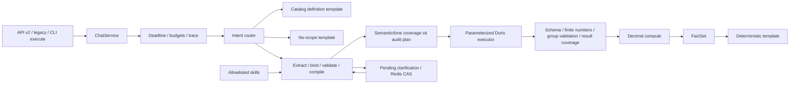

# Vận hành và nghiệm thu Accuracy v2.2

## Trạng thái triển khai

Mã nguồn đã có service dùng chung, API v2/legacy adapter, bounded repair/retry, Redis CAS, năm skills và evaluation harness. V2.2 bổ sung semantic/time/result coverage, PlanningOutcome có kiểu, sửa input clarification và load qua HTTP. Chi tiết ở [spec hardening](chatboy-accuracy-v2.2-hardening.md); báo cáo thực tế ở [implementation-validation.md](../evaluation/implementation-validation.md).

Những phần cần môi trường/người phụ trách trước phát hành:

- Snapshot Doris độc lập và SQL chuẩn cho từng ca số liệu.
- Nghiệp vụ kiểm tra đơn vị, công thức, phạm vi mẫu số và duyệt đáp án của 150 ca; đóng băng holdout.
- Integration trên phiên bản Doris triển khai thực tế, ba lượt live evaluation và load test.
- Smoke trên hạ tầng triển khai và xác minh HA/backup Redis. Smoke local đã có hai image replica cùng Redis thật; LLM/Doris trong smoke vẫn là fixture/rules.

## Kiến trúc và hành vi



LLM tối đa 4 lần gọi vật lý/yêu cầu, gồm đổi key và retry. Mỗi lần tối đa 8 giây theo cấu hình client; semantic repair tối đa 1 lần cho toàn request; transport retry tối đa 1 lần. Lỗi router không biến thành `data_query`. Chỉ mode rules được chọn tường minh mới dùng rules.

Deadline monotonic toàn yêu cầu 45 giây. Admission tối đa 5 yêu cầu/replica, chờ tối đa 1 giây; kiểm tra budget tại từng bước. Doris dùng `SET query_timeout`, connect/read/write timeout tối đa 5 giây và fetch theo batch. HTTP timeout không được coi là đã hủy câu SQL: server timeout và đóng connection vẫn là cơ chế giới hạn thực thi.

Không chèn LIMIT kỹ thuật để âm thầm cắt kết quả. Tổng số dòng đọc trong request vượt 50.000 sẽ trả `resource_exceeded`. Top-N do người dùng yêu cầu được giữ trong plan; các pattern liệt kê/breakdown không còn default LIMIT 100. Văn bản chỉ hiển thị 100 dòng; `data` và evidence giữ phần kết quả hợp lệ đầy đủ.

Mọi khoảng ngày là `[start,end)`, reference time theo `Asia/Ho_Chi_Minh`. Giữ quy ước tuần/tháng trước là khoảng lùi đến hôm qua. So sánh tháng 6/tháng 8 chạy hai truy vấn riêng. `X so với Y` dùng Y làm kỳ gốc; danh sách hai kỳ không chỉ rõ hướng dùng thứ tự thời gian. Không cộng KPI ngày để suy ra KPI tháng.

Quý trước/năm trước dùng kỳ lịch hoàn chỉnh. Quý/năm đang diễn ra kết thúc ở ngày sau reference time; kỳ quá khứ/tương lai giữ đầy đủ biên lịch. Hỗ trợ filter và comparison; trend mặc định theo tháng, giữ grain ngày/tuần/tháng được nêu rõ. Group theo quý/năm chưa được hỗ trợ. Ngày sai trả 422, biểu thức chưa hiểu yêu cầu làm rõ; chỉ thiếu hoàn toàn thời gian mới mặc định hôm qua.

`NULL`, số 0, thiếu alias được xử lý khác nhau; không phát NaN/Infinity. Nhóm thiếu một kỳ/đối tượng không được thay bằng nhóm khác. Không làm tròn bằng float trước khi hiển thị; dùng Decimal và `ROUND_HALF_UP`. Tỷ trọng Top-N được ghi rõ phạm vi, mẫu số 0 không tạo tỷ lệ thay thế.

`ResultCoverage.scope=query_expectations`: thiếu kỳ/nhóm được yêu cầu hoặc có metric NULL làm kết quả `partial` khi vẫn còn dữ liệu. Kết quả rỗng/toàn NULL là `no_data`. Coverage không kiểm chứng freshness hoặc độ đầy đủ của nguồn. V2 công bố `evidence.result_coverage` và `meta.data_status`; legacy có `data_status`.

## Lượt làm rõ

Redis lưu semantic extraction, context, field/options chờ bổ sung, reference time và versions. Chỉ cập nhật slot đang chờ; không ghép văn bản trả lời vào câu hỏi để trích xuất lại mọi ý nghĩa.

- ID tạo bởi server; revision bắt đầu từ 1; tối đa hai lượt bổ sung.
- TTL 900 giây tính từ lúc tạo; cập nhật không gia hạn TTL.
- Lua claim chọn duy nhất một owner cho revision trên nhiều replica.
- Answer sai format/option/time trả 422 với `error.field_errors` và cùng clarification ID/revision. Lua release kiểm tra owner token, giữ PTTL; lượt sai không tiêu thụ round. Client cho người dùng sửa input; không tự gửi lại nguyên payload sai.
- Cùng revision/answers đã hoàn tất nhận lại nội dung đã lưu. Revision đang chạy trả 409; gọi lại cùng answers sau khi hoàn tất để nhận kết quả.
- Answers khác cho revision đã dùng trả 409. Hết TTL, thay catalog/prompt/skills/workflow/model hoặc quá hai lượt: gửi câu hỏi mới.
- Các response replay có request ID mới để trace, kèm `meta.original_request_id`; nội dung câu trả lời, data và evidence giữ nguyên.
- Nếu worker chết giữa claim và complete, revision giữ trạng thái in-flight đến TTL; client có thể gửi một câu hỏi mới. Hệ thống không cho replica thứ hai thực thi lại revision đang có owner.
- Redis lỗi không tạo clarification ID giả. Một câu hỏi độc lập không cần Redis vẫn có thể trả lời.

Nên giữ Redis ở chính sách `noeviction`; khi hết bộ nhớ, tạo clarification thất bại rõ ràng. Compose có AOF và volume; cần kiểm chứng cấu hình HA/backup của môi trường vận hành riêng.

## API và mã lỗi

| HTTP | Mã / trạng thái |
|---|---|
| 200 | `answered`, `needs_clarification`, `no_data`, `unsupported` |
| 422 | `invalid_input`, `resource_exceeded`, `invalid_semantics`, `budget_exceeded` |
| 409 | `clarification_expired`, `clarification_conflict`, `clarification_limit` |
| 502 | `invalid_result` |
| 503 | `dependency_unavailable`, `busy` |
| 504 | `deadline_exceeded` |
| 500 | `internal_error` |

Exception text không phải contract. Response trả request ID, error code/retryable và thông báo ổn định. Trace JSON ghi stage/duration/outcome/error code, model/usage khi provider có trả, SQL fingerprint, số dòng và versions; không sao chép toàn bộ result set vào nhiều file log. Cần cấu hình log collection/retention của môi trường vận hành.

API cũ giữ các trường `success/intent/reply/data/error`, bổ sung status/clarification/request ID/data_status. Decimal legacy được encode thành JSON number bằng simplejson, không đi qua float. V2 khai báo kiểu `decimal` và trả chuỗi chính xác. Lỗi compiler/renderer/compute bất ngờ trả 500, không được biến thành `unsupported` 200.

## Skills và thay đổi catalog

Registry chỉ nạp 5 tên đã đăng ký trong repo. Metadata gồm version và các đường dẫn catalog phải tồn tại; không cấp tool shell hay script cho model. Khi chưa rõ family, giữ cả channel/program trong whitelist; nạp instruction phù hợp với workflow và semantic IDs. Catalog tiếp tục là nguồn công thức.

Thêm KPI phải bổ sung presentation có kiểu; thiếu đơn vị/precision khiến validation khởi tạo thất bại. Thay catalog, prompt, skill hoặc code đổi fingerprint; phiên clarification cũ hết hiệu lực. Chạy regression/replay sau mỗi thay đổi. Không dùng ví dụ holdout đã duyệt để tối ưu prompt.

## Duyệt dataset

`evaluation/cases.jsonl` có 90 ca data (10/pattern), 20 definition, 10 no-scope, 20 clarification và 10 faults. Mỗi KPI có ít nhất 2 ca data, split 100 development / 50 holdout. `group_id` ràng buộc các biến thể cùng nhóm không nằm ở hai split.

Đây là dữ kiện tổng hợp được khai báo trực tiếp; không lấy output renderer làm đáp án. Các số liệu giả lập chỉ kiểm tra wiring/logic, không xác nhận công thức SQL đúng với dashboard.

Nghiệp vụ cần:

1. Chọn snapshot có ngày tham chiếu cố định và xác định bảng nguồn/trọng số/coef/population cùng phiên bản.
2. Viết `reference_queries` độc lập cho từng ca data. Mỗi query có `sql`, `parameters`, `period_id` khi cần. Không copy SQL sinh từ Chatboy làm oracle. Có thể đối chiếu SQL dashboard trong `data/dashboard/rating/references/`.
3. Thay `results`, `expected.rows`, `expected.facts`, semantic plan và các điều kiện lời đáp theo đáp án được xác minh. Bổ sung câu hỏi thực tế và trường hợp lỗi có ý nghĩa, giữ các mức coverage/split.
4. Điền `snapshot_id`, `source`, `review.status=approved`, `review.reviewer`; lưu bằng chứng/phê duyệt và đóng băng file qua quy trình review repo.
5. Chạy `validate`. Mọi thay đổi dataset sau đó đổi hash, buộc chạy lại cả ba lượt live.

`evaluation/build_candidates.py` chỉ dành cho tái tạo bộ **draft giả lập ban đầu**. Không chạy script này lên file dataset đã được duyệt.

## Integration, live và ablation

Tạo file `.env.evaluation` dựa trên `evaluation/env.example`. Mọi endpoint/key phải khai báo tường minh; runner không lấy hoặc nội suy biến thiếu từ `.env` production. Schema bắt buộc có prefix `chatboy_eval_` và `DORIS_DATABASE` phải trùng `EVAL_DORIS_SCHEMA`. DBA tạo marker một dòng trong schema này:

```sql
-- Tạo theo DDL phù hợp với Doris của môi trường; runner chỉ đọc bảng này.
SELECT snapshot_id FROM chatboy_eval_rating_v1.__chatboy_eval_snapshot;
```

Giá trị phải trùng `EVAL_SNAPSHOT_ID` và `snapshot_id` của dataset. Snapshot adapter đổi prefix `data_dashboard_rating.` trong cả SQL sinh và SQL chuẩn sang schema evaluation; từ chối query tham chiếu schema khác. Cần giữ snapshot bất biến trong suốt nghiệm thu.

```bash
python -m src.evaluation integration --env-file .env.evaluation --output artifacts/integration
python -m src.evaluation live --env-file .env.evaluation --output artifacts/live-1
python -m src.evaluation live --env-file .env.evaluation --output artifacts/live-2
python -m src.evaluation live --env-file .env.evaluation --output artifacts/live-3
python -m src.evaluation ablation --ablation-mode live --env-file .env.evaluation --output artifacts/ablation-live
```

Integration dùng semantic fixture đã duyệt với Doris thật. Live dùng LLM và Doris thật cho các ca thông thường; nhóm fault được inject tại boundary tương ứng và ghi rõ trong trace. Oracle SQL chạy trên cùng snapshot và so sánh giá trị numeric chính xác; nếu engine có sai số float, nghiệp vụ phải quyết định cách chuẩn hóa trong SQL chuẩn/schema kết quả, không tự nới tolerance để cho qua.

Khởi động API evaluation riêng rồi chạy load ở terminal khác:

```bash
python -m src.evaluation serve --env-file .env.evaluation --host 127.0.0.1 --port 8011
python -m src.evaluation load --base-url http://127.0.0.1:8011 --output artifacts/load
```

`EVAL_REFERENCE_TIME` phải có timezone và trùng dataset; timeout/TTL vẫn dùng clock thực. `/ready` công bố environment/snapshot/reference time/versions để runner từ chối nhầm môi trường. Endpoint thông thường công bố `environment=runtime` và không đủ điều kiện làm target evaluation.

Load chạy 100 request, burst đầu 5, tiếp theo 8 request/phút. P95 đo client elapsed qua HTTP, bao gồm thời gian chờ và serialization; sai HTTP status hoặc semantic status đều tính lỗi. Kiểm tra metadata trước/sau chạy để phát hiện rollout giữa chừng. Không chạy live load tự động trong CI vì dùng dịch vụ thật và có chi phí. P95 replay để `null`; thời gian giả lập không dùng làm SLA production.

Các mode tạo summary JSON/Markdown/CSV, file từng case và trace JSONL. Ablation so sánh core, core+skills, core+skills+repair. Replay ablation chỉ kiểm tra các nhánh và budget; dùng live để đo ảnh hưởng đến chất lượng hiểu câu hỏi.

```bash
python -m src.evaluation gate \
  --reports artifacts/live-1/summary.json artifacts/live-2/summary.json artifacts/live-3/summary.json \
  --regression-report artifacts/regression.json \
  --load-report artifacts/load/load.json
```

Gate yêu cầu ba run ID khác nhau cùng dataset/code/catalog/prompt/skill versions; holdout ≥95%, từng pattern holdout ≥90%, controls và facts/render 100%, P95 ≤20s, lỗi không kỳ vọng ≤1%, regression đầy đủ không deselect. Load phải `transport=http`, `mode=live`, environment evaluation, ≥100 request, 8 rpm, burst 5, metadata ổn định và đúng dataset/snapshot/versions. Báo cáo service-only, smoke hay fixture chưa duyệt không mở gate.

## Smoke image, HTTP và Redis thật

```bash
docker compose -p chatboy-v22-smoke -f evaluation/docker-compose.smoke.yml up -d --build --wait replica-a replica-b
docker compose -p chatboy-v22-smoke -f evaluation/docker-compose.smoke.yml run --rm runner
docker compose -p chatboy-v22-smoke -f evaluation/docker-compose.smoke.yml down
```

Project riêng không đọc `.env`, không mở cổng host và không dùng production volumes. Runner kiểm tra hai replica khỏe, sửa input sai cùng revision, race/replay chỉ một query, TTL/expiry, partial v2/legacy rồi đo 100 request HTTP (~12 phút). `artifacts/v22-smoke/smoke.json` và `load.json` ghi kết quả. Dùng `run --rm runner python -m src.evaluation.smoke verify --urls http://replica-a:8010 http://replica-b:8010 --requests 5` để chạy nhanh như CI.

Smoke dùng rules và database fixture; không chứng minh chất lượng hiểu câu hỏi của LLM hay khả năng chạy SQL trên Doris thật.

## Rollout và rollback

V2.2 dùng namespace `chatboy:clarification:v2.2:` và state schema `2.2`. Drain traffic/lượt làm rõ của phiên bản trước; không migration hoặc tái dùng JSON state cũ. ID cũ được coi expired và người dùng gửi lại câu hỏi. Giữ cùng code/catalog/skills/model trên các replica nhận chung lượt làm rõ.

Sau khi gate đạt, triển khai thử một replica với snapshot/config phù hợp; smoke test metric lookup, so sánh kỳ, definition, no-scope, clarification và retry từ replica khác. Theo dõi 502/503/504, clarification conflict, latency, budget và query fingerprints. Tăng replica khi các phép đối chiếu nghiệp vụ ổn định.

Rollback image cùng catalog/skills đã duyệt trước đó; dùng phiên bản image và lockfile tương ứng. Các clarification có versions khác bị từ chối theo thiết kế, người dùng cần gửi lại câu hỏi. Không tái sử dụng bộ kết quả live của version trước để duyệt version mới.
