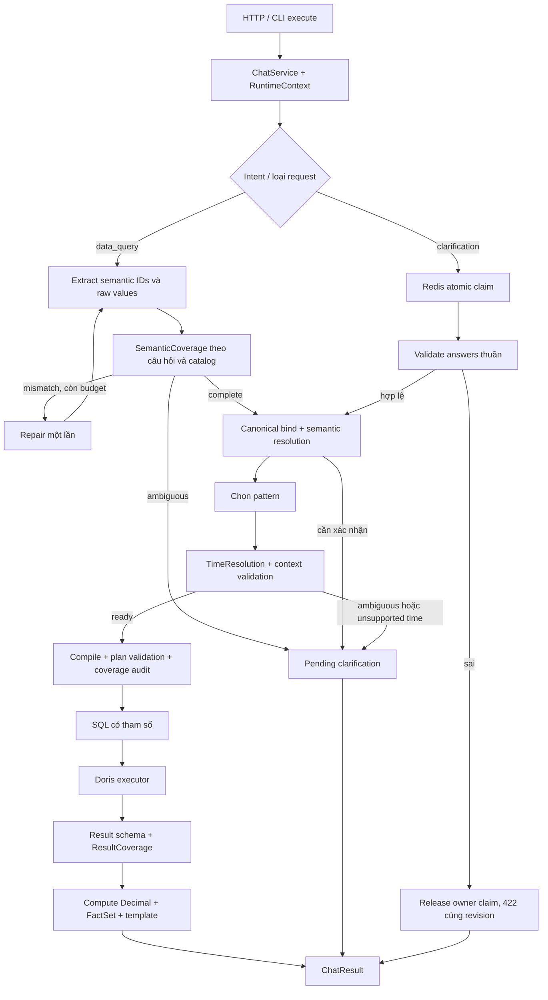

# Chatboy Accuracy v2.2 — Đặc tả sửa kiến trúc và kiểm chứng

Ngày: 26/10/2026. Bổ sung cho [spec Accuracy v2](chatboy-accuracy-v2.md).
Trạng thái: triển khai trong repo; kết quả chạy nằm tại [báo cáo kiểm chứng](../evaluation/implementation-validation.md).

## 1. Mục tiêu và phạm vi

Giữ kiến trúc một ứng dụng với `ChatService` dùng chung cho HTTP, CLI execute và evaluation. LLM nhận diện ngữ nghĩa; catalog quyết định khả năng, công thức và SQL; code tính facts và template trình bày kết quả. Không thêm agent tự chủ, tool shell hay vòng lặp sinh SQL tùy ý.

Sửa năm lỗi được tái hiện trong review:

| Lỗi | Hành vi phải đạt |
|---|---|
| Output LLM hợp schema nhưng bỏ filter hoặc chọn sai KPI hợp lệ | Kiểm tra coverage theo câu hỏi, repair tối đa một lần; không chạy query khi vẫn sai |
| Thời gian không hiểu hoặc ngày sai bị đổi thành mặc định | Phân biệt absent/resolved/ambiguous/unsupported/invalid; chỉ absent mới dùng hôm qua |
| Clarification sai chiếm revision và không thể sửa | Validate thuần, trả 422 cùng ID/revision/TTL, trả claim về pending bằng Lua có owner token |
| Lỗi compiler/renderer/compute bị che thành unsupported HTTP 200 | Lỗi nội bộ trả 500, trace có stage/request ID; unsupported chỉ dành cho capability đã biết |
| Thiếu kỳ/nhóm so sánh vẫn được đánh dấu available | Tính coverage từ kỳ/nhóm được yêu cầu; trả partial, không suy diễn giá trị bị thiếu |

Hoàn thiện thêm evaluation qua HTTP, smoke image với hai replica và Redis thật, versioning, tài liệu và release gate. Điều kiện nghiệm thu nghiệp vụ vẫn cần snapshot Doris và người duyệt độc lập.

## 2. Các quyết định đã chốt

- Hỗ trợ **lọc và so sánh quý/năm**.
- “Quý trước”, “năm trước” là kỳ lịch hoàn chỉnh. Ví dụ reference 24/10/2026: quý trước `[2026-07-01,2026-10-01)`, năm trước `[2025-01-01,2026-01-01)`.
- Kỳ chứa ngày tham chiếu kết thúc ở ngày tham chiếu + 1; kỳ quá khứ và tương lai dùng đầy đủ biên lịch. Chưa có dữ liệu tương lai được xử lý bằng result coverage.
- “Quý này” tại 24/10/2026 là `[2026-10-01,2026-10-25)`; “năm nay” là `[2026-01-01,2026-10-25)`.
- Quý I–IV, quý 1–4, Q1–Q4; có thể chỉ rõ năm. Năm bỏ trống dùng năm của reference time. Range từ quý/năm X đến Y lấy biên cuối exclusive.
- `X so với Y`: Y là baseline `a`, X là target `b`. Hai kỳ liệt kê không chỉ hướng: sắp thứ tự thời gian. Hai kỳ trùng nhau cần làm rõ.
- Quý/năm không phải grain mới. Trend mặc định theo tháng; giữ yêu cầu rõ “theo ngày/tuần/tháng”. “Theo quý/năm” trả unsupported.
- Quy ước tuần/tháng tương đối của v2 giữ nguyên để tránh đổi nghĩa ngoài phạm vi này.
- Tên chương trình đã được xác định phải được che khỏi phân tích KPI, kênh và thời gian. Tên “VTV1 năm 2025” không tự tạo filter kênh hay năm.

## 3. Workflow sau sửa



LLM, repair, retry và SQL tiếp tục bị giới hạn bởi cùng request context. Không reset ngân sách ở từng bước.

## 4. Contract lập kế hoạch

### 4.1 SourceEvidence

Mỗi bằng chứng có `field`, `value`, `source`, `text`, `start`, `end`, `rule_id`.

- `source=question`: trích đoạn từ câu hỏi, vị trí đầu/cuối khi có.
- `source=clarification`: giá trị/option đã được người dùng xác nhận; không gắn span giả vào câu hỏi cũ.
- `source=catalog_default`: policy có tên, như bundle KPI, thứ tự mặc định, phạm vi trọng số.

Không chấp nhận confidence của model làm bằng chứng. Evidence do code tạo từ câu hỏi, lựa chọn hợp lệ và catalog.

### 4.2 SemanticCoverage

`status ∈ {complete, ambiguous, mismatch, unsupported}`; kèm `missing`, `conflicts`, `unresolved`, `candidates`, `reason_code`, `evidence`.

Kiểm tra trước canonical lookup:

1. Chuẩn hóa có bản đồ vị trí về câu gốc; ưu tiên mention dài và alias đặc hiệu như `rating%`.
2. Đọc alias KPI, dictionary dimension và policy từ catalog. Phân biệt family channel/program dựa vào bằng chứng; family mặc định do policy khai báo.
3. Xác nhận KPI và toàn bộ canonical filter được nhắc tới. Không chỉ kiểm tra các value mà LLM đã trả.
4. Bảo vệ tên riêng; chấp nhận alias canonical theo dictionary; không nhận filter model tự tạo.
5. Giữ group-by rõ ràng. Điều kiện phủ định hoặc yêu cầu nhiều KPI độc lập chưa hỗ trợ phải dừng rõ ràng.
6. KPI không đủ bằng chứng: hỏi người dùng chọn KPI từ các option hợp lệ.

Mismatch do output LLM đi vào semantic loop đã có, tiêu thụ **một repair chung toàn request**. Vẫn mismatch sau repair trả `invalid_semantics` 422. Không thêm một lượt “LLM judge”.

Sau compile, audit lại KPI, filter, grouping, limit, sort và time. Dimension tương đương giữa channel/program chỉ được coi tương đương khi metadata vật lý/nhãn tương ứng. Group bị cố định bằng filter một giá trị có thể được rút gọn. Sai lệch do compiler là lỗi nội bộ; không thực thi SQL.

Policy được đặt tại `data/dashboard/rating/semantic_policies.yaml` và được tính vào catalog fingerprint. Không dùng policy để tự động nới đáp án holdout.

### 4.3 TimeResolution

Các trường: `status`, `reference_time`, `source`, `source_text`, `resolved_ranges`, `reason_code`.

| Status | Hành vi |
|---|---|
| `absent` | Dùng ngày hoàn chỉnh trước reference time; ghi `catalog_default` |
| `resolved` | Dùng đúng range hoặc hai range đã resolve |
| `ambiguous` | Clarification `time_range` hoặc `comparison_periods` |
| `unsupported` | Có biểu thức thời gian nhưng chưa hỗ trợ; yêu cầu nhập range rõ ràng |
| `invalid` | 422 `invalid_input` với `field_errors`; không query |

Các định dạng ngày dài/ngắn phải được đối chiếu trên cùng hệ tọa độ. Một phần của `31/02/2025` không được parse lại thành ngày 31 của tháng hiện tại. “Dịp Tết năm 2025” không được bỏ “dịp Tết” và lấy cả năm.

Reference time đóng băng theo request gốc khi resume clarification; deadline dùng monotonic clock thực. Mọi range là `[start,end)` theo ngày nghiệp vụ tại `Asia/Ho_Chi_Minh`.

### 4.4 PlanningOutcome và phân loại lỗi

`kind ∈ {ready, needs_clarification, unsupported}`, kèm reason code và pending fields có kiểu.

- Service quyết định theo outcome, không tìm chuỗi con trong exception message.
- Capability đã biết dùng `UnsupportedRequest` hoặc mã `QueryPlanError` trong allowlist.
- `ValueError`/`RuntimeError` bất ngờ từ compiler, renderer hoặc compute không được chuyển thành unsupported.
- Lỗi nội bộ trả `500 internal_error`; response không chứa exception text. Trace ghi stage và loại exception.
- Known invalid result trả `502 invalid_result`; input sai trả 422; deadline 504; dependency/admission 503.

## 5. Clarification và Redis

Namespace `chatboy:clarification:v2.2:`; state schema `2.2`. State gồm extraction, context, pending fields/options, tên riêng được che, nguồn xác nhận, reference time và versions.

Trình tự:

1. Validate request envelope.
2. Lua claim kiểm tra ID, revision, hash answers và owner token.
3. Validate answer trên bản sao state: đúng field, option tồn tại, format/range hợp lệ. Bước này không gọi LLM hoặc Doris.
4. Nếu invalid: Lua release chỉ xóa claim của token hiện tại, revision hiện tại, chưa complete/closed; giữ nguyên PTTL.
5. Trả 422, `error.field_errors`, clarification có cùng ID/revision/fields/expires_at. Người dùng sửa và gửi lại cùng revision.
6. Nếu hợp lệ: bind lại giá trị cần xác minh, lập plan, thực thi và complete bằng CAS. Chỉ lượt hợp lệ mới tiêu thụ round.

Release cũ không được xóa claim mới. Complete cũ không được tăng revision thêm lần nữa. Release lỗi không được rơi vào nhánh complete/close.

Hai replica cạnh tranh: một owner thực thi; request khác nhận conflict hoặc replay đã lưu. Answers khác sau complete trả 409. Worker chết sau claim giữ in-flight đến TTL; không tự thực thi lại để tránh duplicate query.

TTL tuyệt đối 900 giây; tối đa hai lượt bổ sung hợp lệ. Gửi invalid nhiều lần không kéo dài TTL. Version thay đổi hoặc ID thuộc namespace cũ: expired, yêu cầu gửi câu hỏi mới.

Ví dụ lỗi có thể sửa:

```json
{
  "status": "failed",
  "error": {
    "code": "invalid_input",
    "retryable": false,
    "field_errors": [{"field": "time_range", "code": "invalid_explicit_date", "message": "Cần nhập kỳ thời gian hợp lệ."}]
  },
  "clarification": {"id": "<id gốc>", "revision": 1, "fields": ["<fields gốc>"], "expires_at": "<mốc gốc>"}
}
```

`retryable=false` nghĩa là không tự retry nguyên payload lỗi; client vẫn cho sửa input theo clarification trả về. Ví dụ trên lược các trường request ID/reply/meta và dùng placeholder minh họa.

## 6. ResultCoverage và contract trả lời

`status ∈ {available, partial, no_data, invalid}`; `scope=query_expectations`. Kèm `missing_period_ids`, `missing_groups`, `null_metrics`, `reasons`.

- So sánh kỳ: đối chiếu `a/b`; kiểm tra mỗi nhóm trong hợp các nhóm quan sát được ở cả hai kỳ.
- So sánh dimension: đối chiếu các giá trị filter được yêu cầu trong các nhóm quan sát được.
- Không tạo tích Descartes của mọi filter; không giả định các nhóm chưa xuất hiện phải có dữ liệu.
- Thiếu alias, trùng group hoặc numeric không hợp lệ vẫn là invalid.
- Tập rỗng hoặc tất cả metric NULL là no_data.
- Thiếu một kỳ/nhóm hoặc có NULL trong tập còn dữ liệu là partial; template thông báo thiếu dữ liệu.
- Không thay giá trị thiếu bằng 0 và không tính delta thiếu một vế.
- Baseline bằng 0 vẫn available nếu đủ dữ liệu; absolute delta có thể tính, relative delta là `null`.

Coverage này không chứng nhận freshness, đủ bản ghi nguồn, tính đúng công thức hay completeness của snapshot. Những phần đó cần oracle và kiểm tra nghiệp vụ.

API v2 thêm `evidence.semantic_coverage`, `evidence.time_resolution`, `evidence.result_coverage`; `meta.data_status` giữ trạng thái dữ liệu. API legacy thêm `data_status`. `partial` vẫn là `status=answered`, HTTP 200, kèm cảnh báo và facts chỉ chứa phần tính được.

## 7. Evaluation và release gate

### Bộ ca và regression

Giữ baseline 150 ca: 90 data, 20 definition, 10 no-scope, 20 clarification, 10 faults; 23 KPI, 9 pattern, split 100/50. Không đánh dấu approved tự động.

Bốn câu draft dùng `program.channel_count` được làm rõ bằng cụm “trong dữ liệu chương trình”; giữ nguyên oracle số liệu/plan để tránh đánh đồng đếm kênh của hai fact family. Các case vẫn pending, dataset hash phải đổi.

Regression phải bao phủ: semantic drop/wrong metric và repair thành công; alias chồng lấn; tên riêng; group/limit/order/time sau compile; calendar và invalid date; invalid answer rồi sửa cùng revision; owner race/TTL/replay; nội bộ 500; missing period/group, NULL/0; v2/legacy; HTTP target và release gate.

### API evaluation và load HTTP

`python -m src.evaluation serve --env-file .env.evaluation` khởi động API riêng. Không nạp production `.env`, không nội suy biến môi trường production. Bắt buộc khai báo đủ dependency và schema `chatboy_eval_*`, snapshot marker trùng dataset. `DORIS_DATABASE=EVAL_DORIS_SCHEMA`.

`EVAL_REFERENCE_TIME` có timezone và trùng dataset. Chỉ business reference time được cố định; timeout, thời lượng và Redis expiry dùng thời gian thực.

`/ready` của server evaluation công bố environment, versions, snapshot ID, reference time. Load runner phải kiểm tra metadata trước và sau chạy, từ chối server runtime/snapshot/time sai.

Scenario: 100 request, burst đầu 5, sau đó 8 request/phút. Đo client elapsed qua HTTP gồm queue/serialization. HTTP status và semantic status sai kỳ vọng đều tính lỗi, kể cả HTTP 200 unsupported/clarification.

Release gate yêu cầu load `transport=http`, `mode=live`, môi trường evaluation, scenario đúng, metadata ổn định, dataset/version/snapshot trùng ba lượt live; P95 ≤20 giây, error rate ≤1%. Báo cáo service-only hoặc smoke không đủ điều kiện.

### Smoke image và Redis thật

Compose riêng tại `evaluation/docker-compose.smoke.yml`, không dùng `.env`, production volumes hay cổng host. Dùng production Dockerfile/lockfile, hai replica và Redis thật; database/LLM vẫn là fixture/rules.

Kiểm tra health/readiness, invalid answer release, cross-replica race/replay, TTL, hết hạn, partial v2/legacy và tải HTTP. CI chạy burst 5 nhanh; kiểm chứng thủ công chạy đủ 100 request theo scenario. Kết quả này chứng minh đường HTTP/Redis, không thay live Doris/LLM.

## 8. Ngân sách, rollout và hoàn tất

Giữ nguyên: 45 giây/request; 4 LLM physical calls; 1 semantic repair; 1 transport retry; 5 concurrent/replica; chờ 1 giây; 50.000 dòng; hiển thị 100 dòng; TTL 15 phút; 2 round hợp lệ.

Trước rollout: regression đầy đủ, replay, build/smoke image, snapshot/oracle nghiệp vụ đã duyệt, integration Doris, ba live run cùng version và HTTP load đạt gate. Không tuyên bố production-ready từ fixture.

Drain traffic và clarification cũ khi đổi v2.1 sang v2.2; thông báo người dùng gửi lại câu hỏi cho phiên cũ. Không chuyển JSON state cũ vào namespace mới. Rollback dùng image/catalog/skills đã duyệt trước; không dùng kết quả benchmark của bản khác để mở gate.

Tài liệu vận hành: [runbook](accuracy-v2-runbook.md). Luồng và ví dụ: [question flow/demo](chatboy-question-flow-demo.md). Kết quả thực thi và phần chưa thể nghiệm thu: [validation report](../evaluation/implementation-validation.md).
