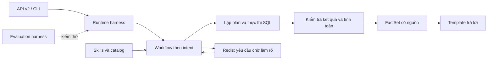

# Spec Chatboy Accuracy v2

## 1. Mục tiêu và các quyết định đã chốt

Nâng cấp Chatboy thành hệ thống trả lời số liệu Rating có thể kiểm chứng xuyên suốt: **hiểu đúng yêu cầu → truy vấn đúng → tính đúng → trình bày đúng**.

Giữ nền tảng Python, FastAPI, Doris và semantic catalog hiện tại. Phạm vi ban đầu bao phủ **23 KPI đang hoạt động và 9 pattern** tại commit `0d9ff42`.

| Nội dung | Quyết định |
|---|---|
| Người dùng, tải | Nội bộ, dưới 10 câu hỏi/phút |
| Trả lời số liệu | Template dựng từ dữ kiện đã kiểm chứng |
| Ngữ cảnh hội thoại | Chỉ lưu yêu cầu đang chờ làm rõ |
| Lưu trạng thái | Redis dùng chung giữa các replica |
| API | Bổ sung API v2; API cũ chuyển thành adapter |
| Độ trễ | P95 ≤ 20 giây; deadline toàn yêu cầu 45 giây |
| Đáp án chuẩn | SQL/dashboard trên dữ liệu cố định, có người nghiệp vụ duyệt |
| Thời gian | Múi giờ `Asia/Ho_Chi_Minh`; giữ quy ước khoảng lùi đến hôm qua đã thống nhất |

Bản này tập trung vào lõi và tích hợp trả kết quả. Xác thực API, bộ nhớ hội thoại dài hạn, agent tự chủ và tác vụ ngoài Rating nằm ngoài phạm vi.

**Các nguyên tắc bắt buộc:**

- LLM chọn ý nghĩa trong khả năng catalog cho phép; SQL và phép tính do code thực hiện.
- Không biến lỗi dịch vụ, dữ liệu thiếu hoặc đối tượng chưa xác minh thành kết quả thành công.
- Mọi số liệu xuất hiện trong câu trả lời phải có nguồn trong kết quả hoặc phép tính đã kiểm chứng.
- Không tự bỏ bộ lọc, đổi KPI hay đổi kỳ thời gian để làm cho truy vấn chạy được.
- Chỉ phát hành khi bộ evaluation đạt các ngưỡng ở mục 4.

## 2. Kiến trúc và contract

### Kiến trúc tổng thể



Tạo một application service dùng chung:

```python
ChatService.handle(request: ChatRequest, context: RequestContext) -> ChatResult
```

API và CLI gọi service này. Giữ khả năng CLI chỉ lập plan; chế độ thực thi sử dụng cùng executor và validator với API.

Các dependency được truyền vào service: LLM client, Doris executor, clock, clarification store, skill registry và trace sink. Test offline thay chúng bằng fixture; không tự đọc cấu hình production rồi kết nối thật.

### Contract nội bộ

| Contract | Nội dung bắt buộc |
|---|---|
| `RequestContext` | Request ID, thời điểm tham chiếu, deadline, số lần gọi đã dùng, phiên bản workflow/model/prompt/catalog/skills |
| `RatingQueryPlan` | KPI, dimensions, filters có nguồn, khoảng thời gian, thứ tự, giới hạn; bổ sung `comparison_spec` khi so sánh kỳ |
| `ComparisonSpec` | Hai kỳ có ID riêng, khoảng `[start, end)`, kỳ gốc và kỳ đích |
| `GeneratedSQL` | SQL tham số hóa, parameters, query ID, period ID và schema đầu ra |
| `ResultSchema` | Ánh xạ semantic ID → alias SQL → kiểu dữ liệu → đơn vị |
| `ValidatedResult` | `available`, `partial`, `no_data` hoặc `invalid`; kèm lỗi kiểm tra |
| `FactSet` | Giá trị KPI, nhóm, kỳ, đơn vị, mẫu số, các chênh lệch và nguồn query |
| `ChatResult` | Trạng thái hội thoại, câu trả lời, dữ liệu, bằng chứng, yêu cầu làm rõ hoặc lỗi |

`FactSet` là đầu vào duy nhất của template số liệu. Không truyền thẳng dòng dữ liệu chưa kiểm tra vào bước trình bày.

### API v2

Endpoint chính: `POST /api/v2/query`.

Hai loại request:

```json
{
  "type": "question",
  "question": "So sánh rating VTV1 tháng 6 và tháng 8"
}
```

```json
{
  "type": "clarification",
  "clarification_id": "server-issued-id",
  "revision": 1,
  "answers": {
    "program_name": "option-id-from-server"
  }
}
```

Với trường cần nhập tự do, giá trị trong `answers` là văn bản của đúng trường đó. Server quyết định trường nhận lựa chọn hay văn bản.

Response gồm:

| Trường | Ý nghĩa |
|---|---|
| `request_id` | Đối chiếu trace |
| `status` | `answered`, `needs_clarification`, `no_data`, `unsupported`, `failed` |
| `intent` | `data_query`, `definition`, `no_scope` |
| `reply` | Nội dung hiển thị |
| `data` | Columns có kiểu dữ liệu, rows và số dòng |
| `evidence` | KPI, bộ lọc, kỳ phân tích, nguồn catalog/dashboard |
| `clarification` | ID, revision, trường còn thiếu, lựa chọn, thời điểm hết hạn |
| `error` | Mã lỗi ổn định và `retryable`; không dùng exception text làm contract |
| `meta` | Phiên bản thành phần, thời gian xử lý, thông tin cắt bớt phần hiển thị |

Quy định kiểu dữ liệu:

- V2 trả `Decimal` dưới dạng chuỗi thập phân chính xác; kiểu `decimal` được khai báo trong columns.
- Integer giữ dạng JSON integer; ngày/giờ dùng ISO 8601; thiếu dữ liệu dùng `null`.
- Không phát `NaN` hoặc vô cực.
- HTTP 200 cho các trạng thái hội thoại hợp lệ; 422 cho đầu vào/giới hạn yêu cầu không hợp lệ; 409 cho lượt làm rõ hết hạn hoặc xung đột; 502 cho kết quả nguồn sai contract; 503 cho dependency không khả dụng; 504 cho hết deadline.

API cũ giữ các trường `success/intent/reply/data/error` thông qua adapter của service mới. Với Decimal trong response cũ, dùng encoder hỗ trợ Decimal trực tiếp, tránh ép qua float trước khi serialize. `simplejson` đáp ứng yêu cầu này. [Tài liệu encoder](https://simplejson.readthedocs.io/en/latest/).

## 3. Đặc tả triển khai theo thành phần

### 3.1. Sửa lõi và chuẩn hóa số liệu

| Hạng mục | Hành vi cần triển khai |
|---|---|
| **Hai kỳ so sánh** | Compiler lưu rõ hai kỳ trong `ComparisonSpec`. Render một truy vấn cho mỗi kỳ bằng recipe hiện có, gắn period ID rồi ghép kết quả theo khóa nhóm. Không lấy hai dòng đầu và không cộng các KPI ngày để suy ra KPI tháng. |
| **Biên thời gian** | Mọi plan dùng `[start, end)`. Nhánh liệt kê chương trình phải dùng cùng quy tắc, không lấy thêm ngày cuối. Chụp một thời điểm tham chiếu cho cả request và các lượt làm rõ. |
| **Đối sánh chương trình** | Exact match duy nhất được chấp nhận. Fuzzy match cung cấp tối đa 5 ứng viên để người dùng xác nhận. Lookup lỗi trả `unavailable`, không trả `matched` hoặc điểm 1.0. |
| **Nguồn của bộ lọc** | Giá trị phải xuất phát từ câu hỏi, lượt xác nhận hoặc default được catalog công bố. Một giá trị tồn tại trong catalog không đủ để cho phép LLM tự thêm vào truy vấn. |
| **Schema kết quả** | Kiểm tra các alias bắt buộc, khóa nhóm, kiểu số và giá trị hữu hạn. Thiếu cột là lỗi contract; thiếu dòng hoặc toàn bộ KPI `NULL` là `no_data`; số 0 vẫn là dữ liệu hợp lệ. |
| **Tính toán** | Không chuyển giá trị lỗi hoặc `NULL` thành 0. Tính trend theo thời gian tăng dần rồi mới áp dụng thứ tự hiển thị. Không thay kỳ bị thiếu bằng kỳ khác. |
| **Đơn vị và định dạng** | Bổ sung metadata có kiểu cho đơn vị, thang đo và số chữ số hiển thị; không suy luận từ chuỗi mô tả hoặc tên KPI. Giữ dấu âm khi định dạng. |
| **Serialize** | Kiểm thử riêng Decimal, date, datetime, null và số lớn tại ranh giới API. |
| **Thực thi Doris** | API, CLI và canonical lookup dùng executor chung, truyền SQL cùng parameters. Không dùng SQL đã nội suy để thực thi. |

Quy tắc bổ sung:

- Với so sánh kỳ có thêm dimension, ghép theo cả period ID và khóa nhóm. Nhóm thiếu một kỳ được đánh dấu thiếu dữ liệu.
- Nếu người dùng nêu hơn hai kỳ cho `period_comparison`, hỏi làm rõ; không tự chọn hai kỳ.
- Giữ nguyên mẫu số đã khai báo trong các recipe chương trình.
- Tỷ trọng trong `rank_comparison` hiện tính trên Top-N phải ghi rõ **“trong Top-N”**. Yêu cầu tỷ trọng toàn phạm vi chỉ được trả lời khi có mẫu số được tính đúng theo catalog.
- Percent hiện được SQL tính theo thang phần trăm: `12.34` hiển thị `12,34%`; không nhân thêm 100.
- Chênh lệch giữa hai tỷ lệ phần trăm dùng **điểm phần trăm**; tăng trưởng tương đối dùng `%`.
- Mẫu số bằng 0 trả tỷ lệ không xác định; không tạo giá trị thay thế.
- Không clamp số liệu để ép vào khoảng “có vẻ hợp lý”.

Bổ sung metadata định dạng cho toàn bộ 23 KPI: count hiển thị 0 chữ số thập phân; các đại lượng khác mặc định 2; thời lượng giây hiển thị theo giờ/phút/giây. Dùng `ROUND_HALF_UP` ở bước hiển thị, không làm tròn trung gian.

### 3.2. Workflow và template

**Data query workflow**

`route → extract → bind → validate context → compile → validate plan → execute → validate rows → compute → build facts → render template`

Mỗi bước nhận contract có kiểu và trả kết quả hoặc trạng thái dừng rõ ràng.

- LLM output phải qua schema và whitelist catalog.
- Model confidence chỉ là dữ liệu chẩn đoán; không thay thế kiểm tra.
- Lỗi router không được tự chuyển thành `data_query`.
- Trường hợp thiếu nghĩa nghiệp vụ chuyển sang làm rõ.
- Lỗi dependency và lỗi code chuyển sang lỗi tương ứng; không diễn giải thành “không có dữ liệu”.

**Definition workflow**

Chọn các mục catalog liên quan, lấy nội dung đã duyệt và trả bằng template: định nghĩa, đơn vị, công thức nghiệp vụ nếu có, khác biệt giữa các KPI và nguồn tham chiếu.

Không tự suy ra công thức còn thiếu. Metric chưa kích hoạt hoặc công thức chưa được duyệt phải được thông báo đúng trạng thái.

**No-scope workflow**

Trả template giới hạn phạm vi và ví dụ phù hợp. Không gọi Doris.

**Template số liệu**

Hoàn thiện riêng cho cả 9 pattern, kể cả `metric_lookup` chỉ có một KPI:

- Luôn nêu kỳ thời gian, đối tượng/bộ lọc chính và đơn vị.
- Ranking nêu thứ hạng; comparison nêu đúng hai phía và chiều biến động.
- Trend không suy đoán nguyên nhân tăng giảm.
- Listing/breakdown xử lý đúng alias và nhóm.
- Phần văn bản hiển thị tối đa 100 dòng; thông báo rõ khi còn dữ liệu trong `data`.
- Không dùng câu chung như “Đã xử lý N dòng” làm câu trả lời thành công cho câu hỏi KPI.

### 3.3. Runtime harness

Runtime harness quản lý vòng đời của mọi workflow.

| Cấu hình mặc định | Giá trị |
|---|---:|
| Deadline toàn request, gồm chờ xử lý | 45 giây |
| Timeout một lần gọi LLM | Tối đa 8 giây và không vượt thời gian còn lại |
| Tổng số lần gọi LLM | Tối đa 4, tính cả retry và đổi API key |
| Timeout truy vấn Doris | Tối đa 5 giây mỗi statement |
| Yêu cầu đang xử lý | Tối đa 5 mỗi replica |
| Chờ nhận việc | Tối đa 1 giây |
| Giới hạn kết quả nội bộ | 50.000 dòng cho một request |
| Độ dài câu hỏi | 1–4.000 ký tự sau trim |

Yêu cầu thực hiện:

- Dùng deadline dựa trên monotonic clock; kiểm tra trước mọi lần gọi dependency và chuyển bước.
- Đặt timeout phía Doris và timeout phía client. Hủy coroutine không được coi là đã hủy truy vấn.
- Khi hết ngân sách, dừng phát sinh công việc mới, đóng tài nguyên và trả lỗi có mã.
- Không âm thầm cắt dữ liệu rồi tính tỷ trọng hoặc xu hướng trên phần còn lại. Vượt giới hạn phân tích phải yêu cầu thu hẹp phạm vi.
- Phân biệt giới hạn Top-N do người dùng yêu cầu với giới hạn tài nguyên.
- Không giữ trạng thái request trong singleton pipeline dùng chung.
- Khởi tạo và kiểm tra dependency/configuration qua vòng đời ứng dụng; cung cấp các implementation giả lập cho test.

Trace mỗi bước cần có:

`request_id`, stage, attempt, duration, outcome, error code, fallback reason, query fingerprint, số dòng, model ID, token usage nếu provider trả về, các phiên bản catalog/prompt/skill/workflow.

Mặc định ghi log JSON có cấu trúc, không nhân bản toàn bộ result set vào nhiều file. Evaluation lưu artifact đầy đủ để replay. Không ghi nhận token/cost ước lượng như số liệu thực tế của provider.

### 3.4. Loop có giới hạn và lượt làm rõ

**Loop sửa lỗi kỹ thuật**

- Cho phép tối đa **một lần sửa semantic output** trong một request.
- Chỉ áp dụng cho lỗi JSON/schema, ID không hợp lệ hoặc output vi phạm contract.
- Đầu vào sửa gồm câu hỏi gốc, catalog hợp lệ và danh sách lỗi validator.
- Output sửa phải đi qua toàn bộ các bước kiểm tra lại.
- Không cho LLM sửa SQL, bỏ filter hoặc thay KPI để vượt validator.
- Retry lỗi mạng/429/5xx tối đa một lần, có backoff, vẫn tính vào giới hạn 4 lần gọi và deadline.
- Không retry dữ liệu rỗng, đối tượng mơ hồ hoặc lỗi công thức.

**Loop làm rõ với người dùng**

Redis lưu: câu hỏi gốc, semantic state, các trường chờ bổ sung, ứng viên đã xác minh, thời điểm tham chiếu, phiên bản catalog/skills, revision và số lượt.

Quy tắc:

- TTL tuyệt đối 15 phút; tối đa 2 lượt bổ sung.
- Câu hỏi mới không mang clarification ID được xử lý độc lập.
- Chỉ cập nhật các trường đang chờ bổ sung; không nối văn bản rồi chạy lại như một câu hỏi hoàn toàn mới.
- Sau khi bổ sung, chạy lại các bước kiểm tra liên quan trước khi thực thi SQL.
- Dùng cập nhật nguyên tử để hai replica không cùng xử lý một revision.
- Request lặp cùng revision và answers nhận kết quả đã lưu; answers khác với revision đã dùng nhận conflict.
- Catalog/skill version đã thay đổi hoặc trạng thái hết hạn: yêu cầu gửi lại câu hỏi, không tự di chuyển ngữ cảnh cũ.
- Redis không khả dụng: không tạo lượt làm rõ giả; trả lỗi dependency. Câu hỏi độc lập không cần trạng thái vẫn có thể xử lý.

### 3.5. Skills nghiệp vụ

Skills là các gói hướng dẫn được **runtime Chatboy nạp theo workflow**. Dùng cấu trúc `SKILL.md`, metadata phiên bản và tài liệu tham chiếu theo chuẩn Agent Skills. [Đặc tả](https://agentskills.io/specification).

Triển khai 5 gói:

| Skill | Trách nhiệm |
|---|---|
| `rating-semantics` | Phân biệt KPI, liệt kê/đếm, filter/group-by và nguồn của giá trị |
| `rating-channel` | Thuật ngữ, aliases và quy tắc chọn KPI kênh |
| `rating-program` | KPI chương trình, tên chương trình, airtime/audience và giới hạn công thức |
| `rating-comparison` | Hai kỳ, baseline/target, đơn vị chênh lệch và mẫu số |
| `rating-definitions` | Tra cứu định nghĩa, công thức và nguồn đã duyệt |

Cơ chế nạp:

- Registry đọc metadata lúc khởi động; workflow nạp nội dung cần thiết theo intent, family và pattern.
- `rating-semantics` được dùng khi extraction; family chưa rõ không được làm mất các KPI hợp lệ khỏi whitelist.
- Sau khi có semantic IDs, nạp đúng metadata chi tiết và kiểm tra khả năng tương thích.
- Catalog YAML tiếp tục là nguồn chuẩn của công thức và capability; skills tham chiếu thay vì sao chép thành nguồn độc lập.
- Chỉ nạp gói đã đăng ký trong repo; không bổ sung shell, script tùy ý hoặc công cụ tự sửa dữ liệu.
- Skill lỗi hoặc tham chiếu catalog không tồn tại làm release validation thất bại.
- Ghi skill ID/version trong trace; examples của skill chỉ lấy từ tập development.

## 4. Evaluation harness và tiêu chí nghiệm thu

### Bộ dữ liệu chuẩn

Tạo tối thiểu **150 test case nghiệp vụ**:

| Nhóm | Số ca tối thiểu |
|---|---:|
| Data query: 10 ca cho mỗi pattern | 90 |
| Definition | 20 |
| No-scope | 10 |
| Hội thoại làm rõ | 20 |
| Lỗi dependency, budget và dữ liệu | 10 |

Các ca data query phải bao phủ cả 23 KPI, mỗi KPI xuất hiện ít nhất hai lần. Bổ sung bộ regression kỹ thuật độc lập cho các lỗi đã tái hiện.

Mỗi case lưu:

- Câu hỏi hoặc chuỗi lượt hội thoại; thời điểm tham chiếu cố định.
- Intent, semantic plan hoặc trạng thái mong đợi.
- SQL tham chiếu độc lập, dataset snapshot ID và kết quả chuẩn.
- Các facts bắt buộc và nội dung không được xuất hiện.
- Phiên bản catalog, nguồn, người duyệt và trạng thái phê duyệt.

Không tạo đáp án chuẩn bằng chính renderer đang được đánh giá.

Chia **100 development / 50 holdout**, giữ các biến thể cùng câu hỏi trong cùng một tập để tránh rò rỉ. Người nghiệp vụ duyệt và đóng băng holdout trước khi tối ưu prompt/skills.

### Các chế độ chạy

| Chế độ | Mục đích |
|---|---|
| **Replay offline** | Fixture LLM/Doris, clock cố định, chặn network; chạy trên mọi PR |
| **Doris integration** | Chạy SQL sinh ra và SQL chuẩn trên cùng snapshot Doris |
| **Live evaluation** | LLM thật với snapshot đã duyệt; đo chất lượng hiểu câu hỏi, độ trễ và usage |
| **Ablation** | So sánh bản lõi đã sửa với từng tính năng skills/repair được bật |

Evaluation harness phải xuất báo cáo tổng hợp, kết quả từng case, khác biệt semantic/result/facts và trace truy nguyên. Đây là chức năng đo toàn bộ hệ thống, bao gồm workflow và runtime, phù hợp với cách phân biệt evaluation harness và agent harness. [Tài liệu tham khảo](https://www.anthropic.com/research/demystifying-evals-for-ai-agents).

### Kiểm thử bắt buộc

- Tháng 6 so với tháng 8, đảo thứ tự dòng, thiếu kỳ hoặc thiếu nhóm.
- Liệt kê chương trình đúng một ngày; ranh giới tháng/năm và qua nửa đêm Việt Nam.
- Lookup timeout, tên không tồn tại, nhiều tên gần giống và fuzzy cần xác nhận.
- LLM tự thêm một filter hợp lệ nhưng không được người dùng nêu.
- Thiếu alias, sai kiểu, `NULL`, 0, số âm, Decimal, NaN và vô cực.
- Đơn vị percent, điểm phần trăm, thời lượng và chênh lệch âm.
- Mẫu số bằng 0; tỷ trọng Top-N và tỷ trọng toàn phạm vi.
- Template KPI đơn, bundle và đủ 9 pattern.
- Vượt giới hạn repair, key rotation, deadline và kích thước kết quả.
- Redis mất kết nối, TTL hết hạn, retry trùng và hai replica resume đồng thời.
- API v2, adapter v1 và CLI cho cùng facts.
- Mọi test offline không phát sinh kết nối Doris/LLM thật.

### Release gates

| Chỉ số | Điều kiện |
|---|---|
| Unit, integration và regression kỹ thuật | 100% đạt |
| Các ca lỗi nghiêm trọng đã biết | 100% đạt |
| Tính nhất quán reply ↔ FactSet | 100% trên tập nghiệm thu |
| End-to-end correctness trên câu hỏi có đáp án | ≥95% holdout, trong từng lần của 3 lần chạy live |
| Từng pattern | ≥90% qua các lần chạy |
| Case cần làm rõ, no-scope và dependency fault | 100% đúng hành vi kiểm soát |
| Độ trễ | P95 ≤20 giây trên yêu cầu trả lời thành công |
| Lỗi kỹ thuật trong bài đo tải | ≤1% |

Câu hỏi có đáp án nhưng hệ thống từ chối, hỏi lại không cần thiết hoặc hết thời gian được tính là chưa đạt.

Chấm số đếm bằng equality; Decimal bằng giá trị chính xác; số thực dùng sai số `max(1e-8, abs(expected) × 1e-6)`. Giá trị đã định dạng trong câu trả lời phải khớp quy tắc hiển thị được duyệt.

Bài đo tải gồm ít nhất 100 request ở mức 8 request/phút, có burst 5 request; không dùng response cache để làm đẹp kết quả.

## 5. Thứ tự triển khai và phát hành

| Mốc | Sản phẩm bàn giao | Điều kiện hoàn thành |
|---|---|---|
| **M1 — Baseline evaluation** | Runner offline, fixture độc lập, ca tái hiện lỗi, báo cáo baseline | Tái hiện được các lỗi review và chặn được network ngoài ý muốn |
| **M2 — Lõi chính xác** | Contract mới, sửa thời gian/binding/schema/compute, đủ template | Bộ test hiện có và regression mới đạt |
| **M3 — Runtime và Workflow** | Service chung, executor, budgets, traces, API v2 và adapter | API/CLI nhất quán; timeout và lỗi không bị che giấu |
| **M4 — Loop và Redis** | Repair có giới hạn, lưu/resume clarification giữa replica | Đạt test TTL, concurrency, replay và dependency failure |
| **M5 — Skills và nghiệm thu** | Registry, 5 skills, 150 case đã duyệt, báo cáo ablation/live | Đạt toàn bộ release gates |

Các module mới được tổ chức thành ba vùng: runtime trong `src/core/text_to_sql/runtime/`, evaluation trong `src/evaluation/`, và skills trong `data/dashboard/rating/skills/`. Giữ các recipe và module ngữ nghĩa hiện có, mở rộng qua contract thay vì viết lại toàn bộ.

Đóng gói mỗi release bằng một bộ phiên bản cố định: code, dependencies, model config, prompt, catalog, skills và evaluation dataset.

Sau khi đạt gates, chạy pilot nội bộ tối thiểu 100 câu hỏi trong ít nhất hai ngày; người nghiệp vụ đối soát 30 câu trả lời lấy mẫu. Chỉ mở rộng khi không còn lỗi sai số liệu nghiêm trọng và đạt mục tiêu độ trễ. Rollback về bộ phiên bản gần nhất đã vượt gates; tắt riêng skill/repair nếu ablation cho thấy hồi quy, luôn giữ các sửa lỗi lõi và validator bắt buộc.
