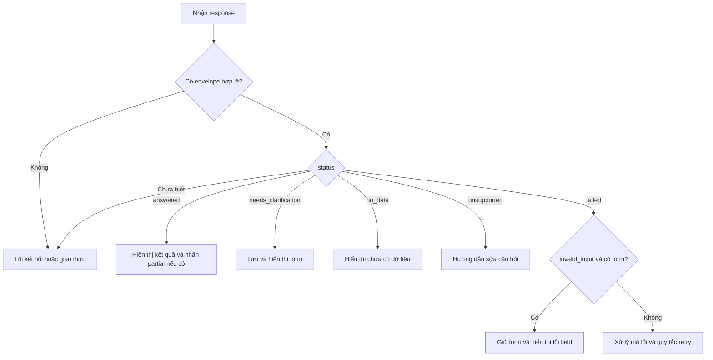

# Hướng dẫn tích hợp Frontend — Chatboy Accuracy v2.2

Ngày đối chiếu contract: 27/10/2026. Tài liệu dành cho frontend tích hợp API hiện tại, độc lập với React, Vue hoặc framework giao diện khác.

Sử dụng **`POST /api/v2/query`** và phân nhánh theo **`status`**, **`error.code`**, **`meta.data_status`**. HTTP 200 có thể là câu trả lời, yêu cầu bổ sung thông tin, chưa có dữ liệu hoặc yêu cầu chưa được hỗ trợ.

Các số liệu, ID và thời điểm trong ví dụ là minh họa. Phải lấy clarification ID, revision, options và thời điểm hết hạn từ response thực tế. Những JSON ghi là **trích đoạn** chỉ trình bày phần liên quan; các response mẫu đầy đủ giữ toàn bộ trường cấp ngoài nhưng có thể rút gọn `evidence`, `meta` và nội dung `reply`. Khi dùng làm mock, cập nhật `expires_at` theo đồng hồ của bài kiểm thử.

## 1. Endpoint và cấu hình kết nối

| Thành phần | Giá trị |
|---|---|
| Base URL local | `http://localhost:8010` |
| Endpoint chat | `POST /api/v2/query` |
| Content-Type request/response | `application/json` |
| Cách trả kết quả | Một response JSON sau khi xử lý xong; chưa có streaming token |
| Deadline backend mặc định | 45 giây |
| Timeout frontend đề xuất | 60 giây để nhận được lỗi deadline từ backend |
| Thời gian giữ clarification | 15 phút từ lúc tạo; không gia hạn khi gửi câu trả lời |

Ví dụ gọi câu hỏi mới:

```bash
curl -sS http://localhost:8010/api/v2/query \
  -H 'Content-Type: application/json' \
  -d '{"type":"question","question":"Lượt xem VTV1 ngày 2026-06-10"}'
```

Nếu frontend chạy ở origin khác, ví dụ `http://localhost:5173`, cấu hình dev proxy chuyển `/api` tới `http://localhost:8010` và gọi `/api/v2/query` bằng URL tương đối. Khi triển khai, có thể đặt reverse proxy cùng origin. `api.py` hiện chưa khai báo CORS middleware; gọi trực tiếp khác origin cần bổ sung cấu hình CORS phù hợp ở backend hoặc gateway. `mode: "no-cors"` không cho frontend đọc JSON response.

Các endpoint liên quan:

| Endpoint | Mục đích / giới hạn |
|---|---|
| `GET /health` | Kiểm tra tiến trình; trả `status: "ok"` và phiên bản |
| `GET /ready` | Kiểm tra Redis; không xác nhận LLM hoặc Doris hoạt động tốt |
| `GET /docs`, `GET /openapi.json` | Xem request schema; response schema hiện chưa đầy đủ |
| `/api/query`, `/query` | API legacy, có cấu trúc response khác; tích hợp mới dùng V2 |
| `POST /api/dictionary/program-names/sync` | Đã ngừng hỗ trợ, trả HTTP 410 |

Route V2 chưa khai báo `response_model`. OpenAPI hiện mô tả response 200 bằng schema rỗng và vẫn có schema lỗi 422 mặc định của FastAPI, trong khi handler thực tế trả envelope của Chatboy. Dùng contract trong tài liệu này và source để khai báo response; chưa dựa hoàn toàn vào client sinh từ OpenAPI. Các endpoint health/readiness và lỗi HTTP ngoài route chat không dùng envelope chat.

## 2. Hai loại request

### 2.1. Câu hỏi mới

```json
{
  "type": "question",
  "question": "Lượt xem VTV1 ngày 2026-06-10"
}
```

### 2.2. Bổ sung cho một câu hỏi đang chờ

```json
{
  "type": "clarification",
  "clarification_id": "aaaaaaaaaaaaaaaaaaaaaaaaaaaaaaaa",
  "revision": 1,
  "answers": {
    "time_range": "từ 2026-06-01 đến 2026-06-02"
  }
}
```

| Trường | Ràng buộc |
|---|---|
| `type` | Gửi rõ `question` hoặc `clarification` |
| `question` | Chuỗi không rỗng sau khi bỏ khoảng trắng hai đầu; tối đa 4.000 ký tự |
| `clarification_id` | 32 ký tự hex viết thường; lấy nguyên từ `clarification.id` |
| `revision` | Số nguyên `1` hoặc `2`; lấy từ response hiện tại |
| `answers` | Object có 1–20 trường; mỗi giá trị là chuỗi không rỗng, tối đa 4.000 ký tự |
| Key trong `answers` | Chỉ các ID trường đang chờ trong `clarification.fields` |
| Trường ngoài contract | Bị từ chối; chưa nhận `conversation_id`, `user_id`, `messages`, `details` hoặc `no_llm` ở V2 |

Frontend nên gửi đầy đủ các trường của form hiện tại để giảm số lượt bổ sung. `answers` là object chứa chuỗi, kể cả khi người dùng chọn KPI hoặc dimension. Không gửi mảng option, object option hay nhãn hiển thị thay cho option ID.

`request_id` dùng để tra log cho một request. `clarification_id` liên kết các lượt bổ sung của cùng câu hỏi. Gửi câu bổ sung bằng `type: "question"` sẽ bắt đầu một câu hỏi độc lập.

## 3. Envelope response và kiểu TypeScript

### 3.1. Các trường cấp ngoài

| Trường | Kiểu | Cách dùng |
|---|---|---|
| `request_id` | string | ID để tra log, hiển thị khi cần hỗ trợ |
| `status` | enum | Điều khiển trạng thái UI |
| `intent` | string hoặc null | `data_query`, `definition`, `no_scope`; có thể null khi chưa phân loại |
| `reply` | string | Nội dung hiển thị cho người dùng |
| `data` | object hoặc null | Bảng dữ liệu |
| `evidence` | object | Thông tin giải thích, kiểm chứng; có thể `{}` |
| `clarification` | object hoặc null | Form bổ sung thông tin |
| `error` | object hoặc null | Mã lỗi, khả năng retry, lỗi từng trường |
| `meta` | object | Metadata; có thể `{}`, các thuộc tính bên trong là tùy chọn |

Backend trả đủ chín trường cấp ngoài qua `ChatResult.as_v2()`. `reply` có thể chứa xuống dòng, danh sách hoặc Markdown cơ bản. Render text giữ xuống dòng hoặc Markdown với raw HTML bị tắt; không dùng nội dung `reply` để suy ra status, số liệu hay cấu trúc form.

### 3.2. Kiểu dùng ở frontend

```typescript
type ChatStatus =
  | "answered"
  | "needs_clarification"
  | "no_data"
  | "unsupported"
  | "failed";

type ChatRequest =
  | {
      type: "question";
      question: string;
    }
  | {
      type: "clarification";
      clarification_id: string;
      revision: 1 | 2;
      answers: Record<string, string>;
    };

interface Clarification {
  id: string;
  revision: 1 | 2;
  expires_at: string;
  fields: Array<{
    id: string;
    label: string;
    input: "text" | "choice";
    options: Array<{
      id: string;
      label: string;
    }>;
  }>;
}

interface QueryData {
  columns: Array<{
    name: string;
    semantic_id?: string;
    type: "integer" | "decimal" | "date" | "string";
    unit?: string | null;
  }>;
  rows: Array<Record<string, string | number | null>>;
  row_count: number;
}

interface ChatResponse {
  request_id: string;
  status: ChatStatus;
  intent: "data_query" | "definition" | "no_scope" | null;
  reply: string;
  data: QueryData | null;
  evidence: Record<string, unknown>;
  clarification: Clarification | null;
  error: {
    code: string;
    retryable: boolean;
    field_errors?: Array<{
      field: string;
      code: string;
      message: string;
    }>;
  } | null;
  meta: {
    data_status?: "available" | "partial" | "no_data";
    display_truncated?: boolean;
    display_limit?: number;
    replayed?: boolean;
    original_request_id?: string;
    duration_ms?: number;
    llm_attempts?: number;
    repairs?: number;
    transport_retries?: number;
    versions?: Record<string, unknown>;
    [key: string]: unknown;
  };
}
```

Đây là kiểu mô tả contract hiện tại; TypeScript không kiểm tra JSON lúc runtime. Tầng nhận response cần phát hiện body không đúng envelope và có nhánh dự phòng cho status/mã lỗi chưa biết. `error.code` được để là string để frontend vẫn tiếp nhận mã mới.

## 4. Các trạng thái và payload mẫu

| HTTP | `status` | Điều kiện | UI |
|---|---|---|---|
| 200 | `answered` | `intent=data_query`, dữ liệu đầy đủ | Câu trả lời và bảng/biểu đồ |
| 200 | `answered` | `meta.data_status=partial` | Kết quả hiện có, kèm nhãn dữ liệu chưa đầy đủ |
| 200 | `answered` | `intent=definition` | Nội dung giải thích; `data` có thể null |
| 200 | `needs_clarification` | Có `clarification` | Dựng form text/choice |
| 200 | `no_data` | Chưa có số liệu | Thông báo chưa có dữ liệu |
| 200 | `unsupported` | Ngoài phạm vi hoặc chưa hỗ trợ | Hướng dẫn sửa câu hỏi |
| 4xx/5xx | `failed` | Có `error` | Xử lý theo mã lỗi và ngữ cảnh request |

### 4.1. Trả lời thành công bằng số liệu

Response HTTP 200; phần evidence/metadata đã rút gọn:

```json
{
  "request_id": "00000000-0000-4000-8000-000000000001",
  "status": "answered",
  "intent": "data_query",
  "reply": "Kênh truyền hình: VTV1. Kỳ: 2026-06-10 đến 2026-06-10.\n- Lượt xem: 123 lượt",
  "data": {
    "columns": [
      {
        "name": "total_channel_views",
        "semantic_id": "rating.total_channel_views",
        "type": "integer",
        "unit": "lượt"
      }
    ],
    "rows": [
      {"total_channel_views": 123}
    ],
    "row_count": 1
  },
  "evidence": {},
  "clarification": null,
  "error": null,
  "meta": {
    "data_status": "available",
    "display_truncated": false,
    "display_limit": 100
  }
}
```

Hiển thị `reply`; nếu dựng bảng, lấy thứ tự từ `columns` và đọc ô bằng `row[column.name]`. Đóng form clarification của lượt chat đã hoàn tất. Các pattern metric lookup, danh sách, phân rã, Top-N, xu hướng, tỷ trọng và so sánh đều sử dụng cùng cấu trúc bảng.

### 4.2. Có dữ liệu nhưng thiếu một phần

Ví dụ so sánh Average Reach tháng 6 với tháng 8, thiếu kỳ đích. HTTP vẫn là 200 và `status` vẫn là `answered`:

```json
{
  "request_id": "00000000-0000-4000-8000-000000000002",
  "status": "answered",
  "intent": "data_query",
  "reply": "Dữ liệu chưa đầy đủ cho một số kỳ, nhóm hoặc chỉ số được yêu cầu.\nKênh truyền hình: VTV1. Kỳ gốc: 2026-06-01 đến 2026-06-30; kỳ đích: 2026-08-01 đến 2026-08-31.\n- Average Reach: kỳ gốc 100,00 người; kỳ đích chưa có dữ liệu; chưa đủ dữ liệu để tính chênh lệch",
  "data": {
    "columns": [
      {
        "name": "ave_reach",
        "semantic_id": "rating.average_reach",
        "type": "integer",
        "unit": "người"
      },
      {"name": "period_id", "type": "string"}
    ],
    "rows": [
      {"ave_reach": 100, "period_id": "a"}
    ],
    "row_count": 1
  },
  "evidence": {
    "result_coverage": {
      "status": "partial",
      "scope": "query_expectations",
      "missing_period_ids": ["b"],
      "missing_groups": [{"period_id": "b", "group": {}}],
      "null_metrics": [],
      "reasons": ["missing_period", "missing_group"]
    }
  },
  "clarification": null,
  "error": null,
  "meta": {
    "data_status": "partial",
    "display_truncated": false,
    "display_limit": 100
  }
}
```

Hiển thị phần dữ liệu hiện có và nhãn **Dữ liệu chưa đầy đủ**. Phần thiếu hiển thị “Chưa có dữ liệu”; giữ nguyên null, không tự bổ sung số 0 hay tính chênh lệch khi thiếu một phía. `scope=query_expectations` chỉ đánh giá độ đầy đủ so với yêu cầu truy vấn, không xác nhận độ mới hoặc độ đầy đủ của toàn bộ nguồn dữ liệu.

### 4.3. Trả lời định nghĩa

HTTP 200. Nội dung `reply` dưới đây được rút gọn:

```json
{
  "request_id": "00000000-0000-4000-8000-000000000003",
  "status": "answered",
  "intent": "definition",
  "reply": "**Thời lượng phát chương trình** (program): Tổng thời lượng phát sóng của chương trình theo lịch EPG. Đơn vị: giây. Nguồn: catalog Dashboard Rating.",
  "data": null,
  "evidence": {
    "catalog_refs": ["program.airtime_duration"]
  },
  "clarification": null,
  "error": null,
  "meta": {}
}
```

Render `reply`; `answered` không bắt buộc phải có bảng. Nếu không tìm được định nghĩa tương ứng, backend có thể trả `unsupported` với `intent=definition` và `catalog_refs=[]`.

### 4.4. Chưa có dữ liệu

HTTP 200:

```json
{
  "request_id": "00000000-0000-4000-8000-000000000004",
  "status": "no_data",
  "intent": "data_query",
  "reply": "Chưa có dữ liệu của ngày 2026-06-10",
  "data": {
    "columns": [
      {
        "name": "total_channel_views",
        "semantic_id": "rating.total_channel_views",
        "type": "decimal",
        "unit": "lượt"
      }
    ],
    "rows": [],
    "row_count": 0
  },
  "evidence": {},
  "clarification": null,
  "error": null,
  "meta": {"data_status": "no_data"}
}
```

Một biến thể của `data` trong response `no_data` là có dòng tổng hợp với giá trị null. Trích đoạn:

```json
{
  "rows": [{"total_channel_views": null}],
  "row_count": 1
}
```

Quyết định UI theo `status`, không chỉ theo `rows.length`. Giá trị `0` hoặc số âm hợp lệ có thể đi cùng `answered`; không chuyển các giá trị này thành trạng thái chưa có dữ liệu.

### 4.5. Ngoài phạm vi hoặc kiểu phân tích chưa hỗ trợ

Ngoài phạm vi Dashboard Rating, HTTP 200:

```json
{
  "request_id": "00000000-0000-4000-8000-000000000005",
  "status": "unsupported",
  "intent": "no_scope",
  "reply": "Tôi hỗ trợ số liệu và định nghĩa trong Dashboard Rating. Bạn có thể hỏi: Rating% là gì? Hoặc: lượt xem VTV1 hôm qua là bao nhiêu?",
  "data": null,
  "evidence": {},
  "clarification": null,
  "error": null,
  "meta": {}
}
```

Yêu cầu dữ liệu chưa được hỗ trợ, ví dụ “Lượt xem ngoại trừ VTV1 hôm qua”. Trích đoạn response HTTP 200:

```json
{
  "status": "unsupported",
  "intent": "data_query",
  "reply": "Yêu cầu có điều kiện hoặc kiểu phân tích chưa được hỗ trợ.",
  "evidence": {"reason": "unsupported_filter_negation"},
  "error": null
}
```

Hiển thị hướng dẫn và cho người dùng sửa câu hỏi; không tự retry nguyên câu. Không hard-code nội dung `reply` hoặc danh sách `reason` để quyết định có hỗ trợ hay không.

## 5. Luồng hỏi lại người dùng

### 5.1. Yêu cầu nhập văn bản

User gửi “Xu hướng lượt xem VTV1 theo ngày”. Backend cần khoảng thời gian và trả HTTP 200. `reply`, evidence và metadata trong mẫu đã rút gọn:

```json
{
  "request_id": "00000000-0000-4000-8000-000000000006",
  "status": "needs_clarification",
  "intent": "data_query",
  "reply": "Hãy bổ sung khoảng thời gian.",
  "data": null,
  "evidence": {},
  "clarification": {
    "id": "aaaaaaaaaaaaaaaaaaaaaaaaaaaaaaaa",
    "revision": 1,
    "fields": [
      {
        "id": "time_range",
        "label": "Khoảng thời gian",
        "input": "text",
        "options": []
      }
    ],
    "expires_at": "2026-10-27T10:15:00+07:00"
  },
  "error": null,
  "meta": {}
}
```

Frontend lưu toàn bộ `clarification`, dựng form và gửi request như mục 2.2. Backend khôi phục câu hỏi/KPI/kênh/pattern đã lưu, bổ sung thời gian rồi chạy tiếp. Khoảng “từ 2026-06-01 đến 2026-06-02” được lưu nội bộ là `[2026-06-01, 2026-06-03)`, bao gồm cả ngày 01 và 02.

### 5.2. Yêu cầu chọn phương án

Trích đoạn `clarification.fields`; options trong ví dụ được rút gọn:

```json
[
  {
    "id": "metric",
    "label": "Chỉ số",
    "input": "choice",
    "options": [
      {"id": "rating.average_reach", "label": "Average Reach"},
      {"id": "rating.total_channel_views", "label": "Lượt xem"}
    ]
  }
]
```

Nếu chọn “Lượt xem”, request có dạng:

```json
{
  "type": "clarification",
  "clarification_id": "bbbbbbbbbbbbbbbbbbbbbbbbbbbbbbbb",
  "revision": 1,
  "answers": {
    "metric": "rating.total_channel_views"
  }
}
```

ID `bbbb...` minh họa một lượt hỏi lại khác; phải thay bằng ID của response có field `metric` đang chờ. Không dùng ID của form thời gian để gửi lựa chọn KPI.

### 5.3. Quy tắc dựng form

| Giá trị | Cách xử lý |
|---|---|
| `fields[]` | Một input cho mỗi phần tử, giữ thứ tự backend trả về |
| `field.id` | Key trong object `answers`; có thể được tạo động |
| `field.label` | Nhãn hiển thị |
| `input=text` | Ô nhập văn bản |
| `input=choice` | Select/radio chọn một option |
| `option.label` | Nội dung hiển thị |
| `option.id` | Giá trị gửi lên backend, giữ nguyên dạng chuỗi |
| `expires_at` | ISO timestamp có timezone; dùng cho thông báo hết hạn |

Các loại trường hiện có:

| Thông tin cần làm rõ | Field ID thường gặp | Dạng |
|---|---|---|
| Khoảng thời gian | `time_range` | text |
| Hai kỳ so sánh | `comparison_periods` | text |
| KPI | `metric` | choice |
| Chiều phân tích | `dimension` | choice |
| Giá trị bộ lọc | `filter_values` | text; 1–5 giá trị phân cách bằng `;` |
| Xác nhận tên chương trình/đối tượng | ID động, ví dụ `program_name_0` | choice nếu có gợi ý, text nếu chưa có |

Backend đã ẩn các thuộc tính nội bộ `kind`, `mapping`, `dimension_id`, `raw_value` khỏi form công khai. Frontend dựa vào `input` và `options`, không tự dựng mapping từ tên trường. Tất cả trường trả lời phải thuộc form đang chờ; form bổ sung không phải giao diện sửa tùy ý mọi bộ lọc của câu hỏi.

### 5.4. Nhập sai rồi sửa trên cùng revision

User nhập “ngày 31/02”. Backend trả HTTP 422:

```json
{
  "request_id": "00000000-0000-4000-8000-000000000007",
  "status": "failed",
  "intent": "data_query",
  "reply": "Cần nhập kỳ thời gian hợp lệ.",
  "data": null,
  "evidence": {},
  "clarification": {
    "id": "aaaaaaaaaaaaaaaaaaaaaaaaaaaaaaaa",
    "revision": 1,
    "fields": [
      {
        "id": "time_range",
        "label": "Khoảng thời gian",
        "input": "text",
        "options": []
      }
    ],
    "expires_at": "2026-10-27T10:15:00+07:00"
  },
  "error": {
    "code": "invalid_input",
    "retryable": false,
    "field_errors": [
      {
        "field": "time_range",
        "code": "invalid_explicit_date",
        "message": "Cần nhập kỳ thời gian hợp lệ."
      }
    ]
  },
  "meta": {}
}
```

Frontend giữ form và nội dung đang nhập, hiển thị lỗi cạnh field tương ứng, dùng `clarification` trong response làm trạng thái mới nhất. Sau khi user sửa, gửi cùng ID/revision với answers mới.

`retryable=false` ngăn việc tự gửi lại nguyên input sai; user vẫn được sửa. Nhánh này không tăng revision, không tiêu thụ lượt bổ sung và không kéo dài TTL. Chỉ áp dụng quy tắc giữ form khi response thực sự có `clarification`; lỗi 422 kiểm tra request tại API có thể không có form hoặc `field_errors`.

### 5.5. Bổ sung hợp lệ nhưng vẫn thiếu thông tin

Backend trả tiếp `needs_clarification` với ID cũ, revision mới và fields còn thiếu. Frontend thay form bằng response mới, giữ các thông tin user đã bổ sung trong lịch sử hiển thị, không tự tăng revision. Hiện tối đa hai lượt bổ sung hợp lệ; sau đó nếu vẫn thiếu thông tin, backend trả `clarification_limit`.

Backend giữ `reference_time` của câu hỏi gốc để xử lý các cụm như “hôm qua” nhất quán qua các lượt. Frontend gửi nguyên câu trả lời thời gian; không tự tính lại ngày dựa trên thời điểm bấm gửi bổ sung.

## 6. Toàn bộ mã lỗi HTTP

Response lỗi mẫu HTTP 503:

```json
{
  "request_id": "00000000-0000-4000-8000-000000000008",
  "status": "failed",
  "intent": "data_query",
  "reply": "Dịch vụ mô hình đang không khả dụng.",
  "data": null,
  "evidence": {},
  "clarification": null,
  "error": {
    "code": "dependency_unavailable",
    "retryable": true
  },
  "meta": {}
}
```

| HTTP | `error.code` | Ý nghĩa | Hành động frontend |
|---|---|---|---|
| 422 | `invalid_input` | Request, ngày, option hoặc trường trả lời không hợp lệ | Hiển thị lỗi; nếu có clarification thì giữ form để sửa |
| 422 | `invalid_semantics` | Không xác định được ngữ nghĩa hợp lệ | Cho diễn đạt lại câu hỏi |
| 422 | `resource_exceeded` | Phạm vi hoặc kết quả vượt giới hạn | Thu hẹp thời gian, đối tượng hoặc số lượng |
| 422 | `budget_exceeded` | Hết ngân sách gọi mô hình trong request | Hiển thị lỗi, cho sửa câu hỏi; không tự lặp nguyên request |
| 409 | `clarification_expired` | Hết hạn hoặc phiên bản context không còn phù hợp | Đóng form cũ, cho gửi câu hỏi mới |
| 409 | `clarification_conflict` | Revision đang xử lý hoặc đã được sử dụng | Xem `retryable` và quy tắc ở mục 7 |
| 409 | `clarification_limit` | Hết lượt bổ sung | Cho gửi lại câu hỏi đầy đủ |
| 502 | `invalid_result` | LLM hoặc nguồn dữ liệu trả kết quả không hợp lệ | Hiển thị lỗi và request ID; không dựng số liệu từ kết quả lỗi |
| 503 | `dependency_unavailable` | LLM, Doris hoặc Redis không khả dụng | Dựa vào `retryable`, loại request và dấu hiệu replay |
| 503 | `busy` | Backend đang bận hoặc hết thời gian chờ | Cho thử lại sau |
| 504 | `deadline_exceeded` | Hết thời gian xử lý | Hiển thị timeout; áp dụng quy tắc retry theo loại request |
| 500 | `internal_error` | Lỗi nội bộ | Hiển thị thông báo chung và request ID để hỗ trợ |

Danh sách trên khớp `ERROR_HTTP` hiện tại. `busy` và `deadline_exceeded` thường có `retryable=true`; `dependency_unavailable` và `clarification_conflict` phụ thuộc nguyên nhân. Luôn đọc cờ từ response, không suy ra chỉ từ HTTP status. Các mã lỗi mới nên đi qua nhánh hiển thị lỗi chung.

`field_errors` là tùy chọn. Mã của từng lỗi field, chẳng hạn `invalid_explicit_date`, `invalid_option`, `unexpected_field`, `invalid_filter_values`, dùng để hỗ trợ UI; thông báo hiển thị lấy từ `message`. Đừng giả định mọi lỗi 422 đều có `field_errors`.

Request bị từ chối trước khi phân loại có thể trả `intent=null`, `meta={}`. Lỗi mạng, response từ proxy, 404/405 hoặc lỗi ngoài handler có thể không có envelope; cần xử lý riêng thay vì cố đọc `error.code`.

## 7. Gửi trùng, retry và kết quả đã lưu

### 7.1. Phân biệt hai loại request

| Tình huống | Hành vi hiện tại / cách xử lý |
|---|---|
| Gửi lại `type=question` | Xử lý như request mới; chưa có khóa chống thực thi trùng cho loại request này |
| Gửi clarification nhưng mất response | Có thể gửi lại đúng ID, revision và answers vừa gửi |
| Cùng revision đang có worker xử lý | HTTP 409 `clarification_conflict`, `retryable=true`; chờ rồi gửi lại đúng payload |
| Revision đã dùng nhưng answers khác | HTTP 409 conflict; không tự đổi revision hoặc gửi liên tục |
| Cùng ID/revision/answers đã hoàn tất | Trả kết quả đã lưu, không thực thi lại query |
| Input sai được trả lại kèm form | Sửa answers và gửi cùng ID/revision |
| Hết TTL | HTTP 409 `clarification_expired`; bắt đầu câu hỏi mới |
| Worker chết sau khi claim, trước khi lưu kết quả | Có thể giữ trạng thái đang xử lý đến hết TTL; cho phép user bắt đầu câu hỏi mới |

Frontend lưu một bản payload đã gửi và khóa submit khi request đang chạy. Với retry sau lỗi mạng hoặc conflict đang xử lý, giữ nguyên answers; không tái tạo từ form mà user có thể đã sửa trong lúc chờ.

### 7.2. Nhận biết replay

Trích đoạn response trả lại kết quả đã lưu:

```json
{
  "request_id": "00000000-0000-4000-8000-000000000009",
  "meta": {
    "replayed": true,
    "original_request_id": "00000000-0000-4000-8000-000000000008"
  }
}
```

Request hiện tại có `request_id` mới. Frontend cập nhật đúng lượt chat đang chờ thay vì thêm hai câu trả lời giống nhau. Replay có thể trả câu trả lời cuối, form revision tiếp theo hoặc response lỗi đã lưu; vẫn phân nhánh theo `status` của response.

### 7.3. Lỗi sau khi claim cũng có thể được lưu

Một clarification xử lý xong với lỗi dependency, chẳng hạn Doris trả lỗi 503, có thể đã bị đóng và lưu response lỗi. Gửi lại cùng payload sẽ nhận cùng lỗi với `meta.replayed=true`, kể cả khi `error.retryable=true`; không có query mới được chạy. Trường hợp lỗi trước khi claim hoặc timeout phía HTTP có thể khác, vì vậy không suy ra mọi lỗi 503 đều đã được lưu.

Mặc định UI không tự retry vô hạn. Khi nhận lỗi đã lưu, hiển thị lỗi và cho bắt đầu lại bằng câu hỏi đầy đủ đã được user xác nhận. Với lỗi chưa nhận được kết quả, cho thử lại đúng payload; nếu chọn tự retry thì giới hạn số lần và thời gian chờ. Mỗi lần đều kiểm tra lại status, replay và thời điểm hết hạn.

## 8. Dữ liệu, số thập phân và evidence

### 8.1. Quy tắc đọc bảng

| Thành phần | Quy tắc |
|---|---|
| `columns[].name` | Key chính xác trong từng row; không cố định tên cột theo một KPI |
| `columns[].semantic_id` | ID nghiệp vụ nếu có; cột bổ sung như `period_id` có thể không có |
| `columns[].unit` | Đơn vị nếu có; có thể null hoặc không xuất hiện |
| `type=integer` | JSON number |
| `type=decimal` | Chuỗi thập phân hoặc null |
| `type=date` | Chuỗi ngày hoặc thời gian ISO; hiển thị đúng ngày/kỳ dữ liệu |
| `type=string` | Chuỗi hoặc null |
| `row_count` | Số dòng kết quả trả về, không phải tổng số dòng bảng nguồn |
| `period_id` | Ghép với kỳ trong `evidence.plan.comparison_spec`, không dựa vào vị trí row |

Trích đoạn dữ liệu số thập phân lớn:

```json
{
  "columns": [
    {
      "name": "total_channel_views",
      "semantic_id": "rating.total_channel_views",
      "type": "decimal",
      "unit": "lượt"
    }
  ],
  "rows": [
    {"total_channel_views": "9007199254740993.25"}
  ],
  "row_count": 1
}
```

Giữ chuỗi khi cần độ chính xác; ép mọi decimal sang `Number` sẽ có thể mất chữ số. Với cột integer lớn hơn giới hạn số nguyên an toàn của JavaScript, backend hiện vẫn trả JSON number: cần parser bảo toàn số lớn trước khi parse, hoặc thống nhất thay đổi backend nếu miền dữ liệu sử dụng các giá trị này. Đổi thành chuỗi sau `JSON.parse` không khôi phục chữ số đã mất.

Giữ phân biệt null, 0 và số âm. Nếu baseline bằng 0, chênh lệch tuyệt đối vẫn có thể hợp lệ nhưng phần trăm thay đổi không xác định; hiển thị theo kết quả backend thay vì chia cho 0. Một chuỗi ngày như `2026-06-01` là ngày dữ liệu; không tự dịch sang ngày khác do chuyển timezone khi dựng biểu đồ.

### 8.2. Giới hạn hiển thị

`meta.display_truncated=true` báo phần trình bày đã giới hạn số dòng. Mặc định `display_limit=100`; `data.rows` hiện vẫn chứa các dòng kết quả backend trả về, không bị cắt theo giới hạn trình bày này. Backend chưa có tham số phân trang server trong contract query. Frontend có thể phân trang hoặc virtualize bảng trên dữ liệu đã nhận.

Giới hạn xử lý mặc định là 50.000 dòng; vượt giới hạn trả `resource_exceeded`. Các chỉ số tăng trưởng, chênh lệch, tỷ trọng tính sau truy vấn có thể nằm trong `evidence.analysis` và `reply`, không tự động trở thành cột mới trong `data.rows`.

### 8.3. Evidence và metadata

| Trường evidence | Nội dung |
|---|---|
| `plan` | KPI, bộ lọc, thời gian, pattern, thứ tự, giới hạn, kỳ so sánh |
| `queries` | Query ID, period ID, fingerprint, parameters, số dòng; không phải SQL đầy đủ |
| `facts` | Giá trị đã kiểm tra, metric, group, period, unit và nguồn query |
| `analysis` | Kết quả tính toán; cấu trúc phụ thuộc pattern |
| `filter_sources` | Giá trị bộ lọc và nguồn `question`/`clarification` |
| `semantic_coverage` | Kiểm tra ngữ nghĩa, nguồn thông tin, phần thiếu hoặc xung đột |
| `time_resolution` | Cách hiểu thời gian, mốc tham chiếu, khoảng đã chọn |
| `result_coverage` | Kỳ/nhóm/chỉ số còn thiếu và lý do |
| `catalog`, `source` | Phiên bản catalog và tên nguồn |
| `catalog_refs` | Các định nghĩa được tham chiếu |
| `reason` | Lý do một kiểu phân tích chưa được hỗ trợ |

Các trường evidence thay đổi theo nhánh xử lý. UI cơ bản dùng `reply`, `data`, `clarification`, `error`, `meta.data_status`; giao diện giải thích có thể đọc thêm evidence và phải chấp nhận các phần vắng mặt. Không dùng `semantic_coverage.status` hoặc `time_resolution.status` thay cho `status` cấp ngoài.

| Trường meta | Ý nghĩa |
|---|---|
| `data_status` | `available`, `partial` hoặc `no_data` cho kết quả dữ liệu |
| `display_truncated`, `display_limit` | Giới hạn trình bày |
| `duration_ms` | Thời gian xử lý backend cho request; không bao gồm toàn bộ latency mạng ở client |
| `llm_attempts`, `repairs`, `transport_retries` | Số lần gọi/sửa/thử lại trong request; dùng chẩn đoán |
| `versions` | Workflow, catalog, skills, model, prompt và cờ bật tính năng; phục vụ đối chiếu |
| `replayed`, `original_request_id` | Nhận diện kết quả được trả lại từ lượt trước |

## 9. Điều khiển trạng thái frontend

### 9.1. Thứ tự xử lý response

| Điều kiện | Hành động |
|---|---|
| Mất mạng, timeout client, body không phải JSON/envelope hợp lệ | Hiển thị lỗi kết nối/giao thức; giữ bản nháp và payload vừa gửi |
| `failed` + `invalid_input` + có clarification | Giữ form, hiển thị lỗi field, cho sửa cùng revision |
| `needs_clarification` | Lưu ID/revision/fields/expiry, dựng form |
| `answered` | Hiển thị reply/data, kiểm tra partial, đóng form của lượt đó |
| `no_data` | Hiển thị trạng thái chưa có dữ liệu, đóng form |
| `unsupported` | Hiển thị hướng dẫn và cho hỏi câu khác |
| `failed` còn lại | Xử lý theo error code, retryable, loại request và replay |
| Status hoặc mã lỗi chưa biết | Nhánh lỗi chung; giữ request ID nếu có |

Luôn đọc body JSON trước khi xử lý lỗi ứng dụng. Nếu chỉ kiểm tra `response.ok` rồi bỏ body khi HTTP 422/409/5xx, frontend sẽ mất form sửa input, mã lỗi và metadata retry. Với client HTTP tự reject các status này, đọc body từ error response.



### 9.2. Trạng thái nên giữ ở client

| Dữ liệu client | Mục đích |
|---|---|
| ID lượt chat do frontend tạo | Gắn request/response vào đúng vị trí hội thoại |
| Câu hỏi gốc và các câu trả lời bổ sung | Hiển thị lịch sử, giúp user tạo lại câu hỏi đầy đủ |
| Clarification hiện tại | ID, revision, fields, expires_at |
| Draft answers | Giữ nội dung khi validate sai hoặc mất mạng |
| Payload đã submit | Retry chính xác, độc lập với draft đang sửa |
| Trạng thái đang gửi và số thứ tự request client | Khóa submit trùng và ngăn response cũ ghi đè trạng thái mới |
| Request ID backend gần nhất | Tra lỗi và hỗ trợ |

Không gửi thêm các trường quản lý UI này vào request backend. Backend chưa có lịch sử hội thoại tổng quát: câu hỏi mới “Còn VTV3 thì sao?” không tự nhận context của câu đã hoàn tất. Nếu user đổi chủ đề khi đang có form, cho bắt đầu câu hỏi mới rõ ràng và bỏ form đang hoạt động ở UI; hiện chưa có endpoint hủy clarification, trạng thái cũ tự hết TTL.

Khi response đến muộn, ghép với lượt/request đã gửi và bỏ qua nếu nó đã bị thay thế ở UI. Đặc biệt, replay của revision cũ có thể chứa một form đã được xử lý ở lượt sau; không hạ revision hoặc mở lại form đã hoàn tất do response cũ.

### 9.3. Loading, timeout và hết hạn

Hiển thị loading trong lúc chờ JSON cuối cùng. Chưa có API công bố tiến độ từng stage hoặc token để dựng tiến độ chính xác. Hủy request bằng AbortController chỉ hủy việc chờ phía client; không bảo đảm dừng thread xử lý backend.

Dùng `expires_at` để hiển thị đếm ngược và đề nghị hỏi lại khi hết hạn; server vẫn là nơi quyết định trạng thái hết hạn. Không tự cộng thêm 15 phút khi nhận form lần hai hay khi nhập sai. Nếu giữ lịch sử UI qua reload, một form cũ chỉ được tiếp tục trong thời hạn server cho phép.

## 10. Các ca kiểm thử nghiệm thu frontend

Dùng mock response để kiểm thử UI trước; kiểm thử tích hợp thật cần cấu hình LLM/Doris/Redis hoạt động. JSON minh họa không chứng nhận chất lượng số liệu production. Mỗi hàng dưới đây là một tình huống cần kiểm tra độc lập.

| Ca | Điều kiện | Kết quả cần đạt |
|---|---|---|
| Thành công một KPI | answered + data_query + một dòng | Hiển thị đúng reply, giá trị và đơn vị |
| Thành công danh sách/xu hướng | Nhiều cột/dòng, có date/string | Bảng dựng theo columns; không hard-code tên KPI |
| Thành công định nghĩa | answered + definition + data=null | Hiển thị nội dung, không lỗi do truy cập rows |
| Dữ liệu thiếu một phần | answered + data_status=partial | Có nhãn thiếu dữ liệu, giữ phần hiện có |
| Thiếu kỳ so sánh | Thiếu period b; delta không xác định | Không điền 0 hoặc tính phần trăm giả |
| Chưa có dòng | no_data + rows=[] | Hiển thị trạng thái chưa có dữ liệu |
| Dòng tổng hợp null | no_data + row_count=1 | Vẫn nhận diện no_data |
| Giá trị 0 / âm | answered + giá trị 0 hoặc âm | Giữ giá trị đúng, không coi là thiếu |
| Decimal lớn | Giá trị decimal là chuỗi dài | Không mất chữ số khi hiển thị/lưu |
| Baseline bằng 0 | Chênh lệch tuyệt đối có, tỷ lệ không xác định | Không chia cho 0; hiển thị đúng kết quả backend |
| Giới hạn hiển thị | display_truncated=true, rows nhiều hơn 100 | Phân trang/virtualize dữ liệu, không hiểu nhầm là mất dòng |
| Ngoài phạm vi | unsupported + no_scope | Hiển thị hướng dẫn, không tự retry |
| Kiểu phân tích chưa hỗ trợ | unsupported + data_query | Hiển thị reply/reason phù hợp |
| Không tìm được định nghĩa | unsupported + definition | Cho sửa câu hỏi |
| Form text | needs_clarification + input=text | Gửi đúng ID/revision/field ID |
| Form choice | input=choice | Hiển thị label, gửi option ID |
| Field ID động/nhiều field | Form có ID chưa hard-code | Dựng đầy đủ form theo metadata |
| Ngày/option sai | 422 invalid_input có clarification | Giữ draft/form, hiển thị field error, sửa cùng revision |
| Request sai cấu trúc | 422 không có clarification/field_errors | Hiển thị lỗi chung, không crash |
| Hỏi tiếp lần hai | needs_clarification revision=2 | Thay form, dùng revision server cấp |
| Hết lượt bổ sung | clarification_limit | Cho gửi lại câu hỏi đầy đủ |
| Hết hạn/đổi phiên bản | clarification_expired | Đóng form cũ, cho hỏi lại |
| Gửi trùng khi đang xử lý | conflict + retryable=true | Không tạo hai lượt chat; retry đúng payload có giới hạn |
| Conflict do answers khác | conflict + retryable=false | Không tự tăng revision hay lặp gửi |
| Replay thành công | meta.replayed=true | Cập nhật lượt cũ, không nhân đôi câu trả lời |
| Replay form | Replay trả needs_clarification | Tôn trọng form hiện tại, không hạ revision đã hoàn tất |
| Replay lỗi dependency | 503 + replayed=true | Không retry vô hạn; cho bắt đầu câu hỏi mới |
| Các mã lỗi còn lại | Mỗi code ở mục 6 | Hiển thị đúng hành động và request ID |
| Metadata/intent trống | meta={} hoặc intent=null | Truy cập tùy chọn an toàn |
| Mất mạng/JSON không hợp lệ | Không có envelope | Hiển thị lỗi riêng, giữ draft/payload |
| Response đến muộn | User đã gửi lượt mới hoặc đóng form | Không ghi đè UI mới |
| Khác origin | Frontend cổng khác API | Gọi được qua proxy hoặc cấu hình CORS |
| Status/mã lỗi mới | Mock giá trị chưa biết | Nhánh dự phòng hoạt động |

## 11. Nguồn contract và tài liệu liên quan

| Nguồn | Nội dung cần đối chiếu |
|---|---|
| [HTTP adapter](../api.py) | Route, validation handler, response và timeout |
| [Request/response contracts](../src/core/text_to_sql/runtime/contracts.py) | Schema, serialization, khác biệt legacy |
| [Error mapping](../src/core/text_to_sql/runtime/errors.py) | Mã lỗi và HTTP status |
| [ChatService](../src/core/text_to_sql/runtime/service.py) | Tạo response, pending fields, resume, data/meta/evidence |
| [Redis clarification store](../src/core/text_to_sql/runtime/clarification.py) | TTL, claim, conflict, replay, complete và sửa input |
| [Runtime limits](../src/core/text_to_sql/runtime/context.py) | Deadline, giới hạn dòng và concurrency |
| [Result validator](../src/core/text_to_sql/d_012_rating_result_validator.py) | Null, 0, schema, available/partial/no_data |
| [Result coverage](../src/core/text_to_sql/result_coverage.py) | Thiếu kỳ/nhóm/chỉ số |
| [Templates](../src/core/text_to_sql/templates.py) | Reply, phần trăm và giới hạn trình bày |
| [Tests Accuracy V2](../tests/test_accuracy_v2.py) | Decimal, HTTP, clarification, replay và binding |
| [Tests hardening V2.2](../tests/test_hardening_v22.py) | Sửa input cùng revision, partial và thời gian |
| [Flow câu hỏi và demo](chatboy-question-flow-demo.md) | Chi tiết xử lý backend và ví dụ nhiều lượt |
| [Runbook](accuracy-v2-runbook.md) | Chạy local, kiểm thử và nghiệm thu |

Khi contract backend thay đổi, cập nhật các type, ví dụ và ca nghiệm thu cùng với frontend. Các giới hạn và hành vi trong tài liệu mô tả V2.2 tại thời điểm đối chiếu; không thay thế việc kiểm tra source của phiên bản được triển khai.
