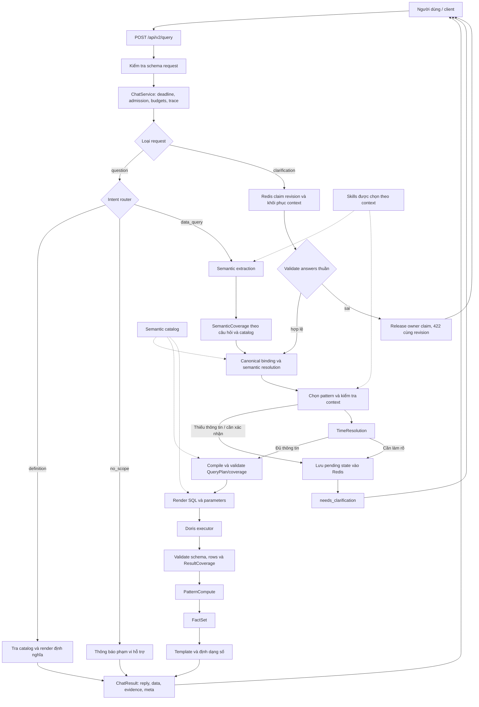
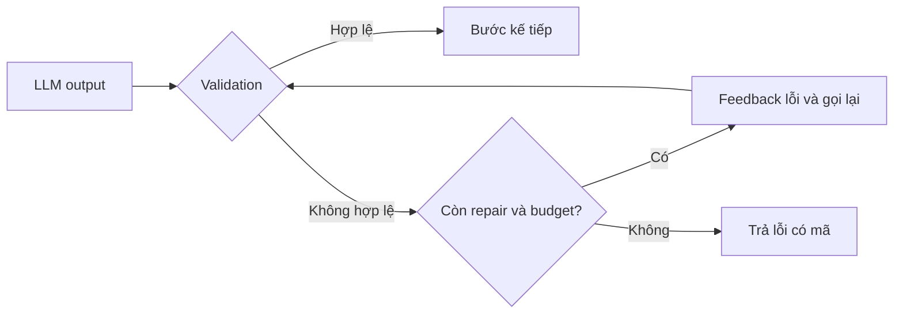

# Chatboy Accuracy v2.2: luồng xử lý một câu hỏi và demo chi tiết

Ngày đối chiếu code và chạy demo: **26/10/2026**.

Tài liệu mô tả hành vi đang có trong repo. Demo chính đi từ câu hỏi **“So sánh Average Reach VTV1 tháng 6 và tháng 8 năm 2026”** đến SQL, dữ kiện và câu trả lời. Hai demo tiếp theo minh họa việc hỏi lại người dùng và sửa output LLM bị lỗi.

**Phạm vi kiểm chứng:** các demo đã chạy qua `ChatService` với LLM/Doris giả lập, Redis trong bộ nhớ bằng `fakeredis` và mạng bị chặn. Plan, SQL, validation, compute, template và logic clarification dùng code ứng dụng thật. Các số **100, 120, 123 là dữ liệu giả lập**, không phải số liệu VTV1 thực tế. Demo gọi service trực tiếp; các request HTTP bên dưới mô tả cách gọi API tương ứng, chưa được gửi đến môi trường thật.

V2.2 bổ sung semantic/time/result coverage và sửa clarification sai cùng revision. Các demo mới ở mục 10. Ngoài demo service, smoke hai container và Redis thật đã có tại `evaluation/docker-compose.smoke.yml`; kết quả HTTP được ghi riêng trong [báo cáo kiểm chứng](../evaluation/implementation-validation.md).

## 1. Bức tranh tổng thể

Một câu hỏi số liệu đi qua chuỗi xử lý:

```text
Câu hỏi → kiểm tra request → xác định ý định → trích xuất ngữ nghĩa
        → chuẩn hóa đối tượng → chọn kiểu phân tích → kiểm tra đủ thông tin
        → lập QueryPlan → kiểm tra plan → tạo SQL có tham số
        → thực thi → kiểm tra dữ liệu → tính toán → FactSet
        → template câu trả lời → JSON trả cho client
```



Sơ đồ lược bớt đường lỗi để dễ đọc. Runtime kiểm tra giới hạn xuyên suốt luồng; các lỗi trả về theo contract ở mục 7.

### Vai trò của các kỹ thuật đã triển khai

| Thành phần | Công việc cụ thể trong Chatboy | Thời điểm tham gia |
|---|---|---|
| **Workflow** | Code điều phối các nhánh `data_query`, `definition`, `no_scope`, `clarification`; chọn thứ tự xử lý | Mỗi request |
| **Runtime harness** | Quản lý deadline, số lần gọi LLM, retry/repair, concurrency, giới hạn dòng, trace và lỗi | Bao quanh mọi bước thực thi |
| **Skills** | Bổ sung hướng dẫn nghiệp vụ vào prompt theo intent, family KPI và pattern | Trước các lần gọi LLM tương ứng |
| **Loop** | Nhận lỗi validation của output LLM, gửi feedback và cho sửa tối đa một lần trong request | Khi router/extractor/pattern trả output không hợp lệ |
| **Semantic catalog** | Quy định KPI, dimension, alias, công thức, recipe, bảng và phạm vi hỗ trợ | Extraction, binding, planning, SQL và presentation |
| **Evaluation harness** | Chạy câu hỏi có đáp án kỳ vọng qua cùng service, so sánh kết quả và lưu artifacts | Khi kiểm thử/đánh giá; không phải một lần gọi thêm trên đường trả lời user |

LLM hỗ trợ hiểu câu hỏi và chọn pattern. Code ứng dụng quyết định cách biên dịch plan, tạo SQL, kiểm tra và trình bày số liệu. Bản hiện tại dùng workflow có giới hạn; chưa có agent tự chủ tự chọn tool hoặc tự sửa SQL. State hội thoại hiện phục vụ các lượt làm rõ đang chờ, chưa phải bộ nhớ hội thoại dài hạn.

## 2. Những gì có sẵn trước khi người dùng gửi câu hỏi

Khi API khởi động, `build_service()` tạo một `ChatService` dùng chung:

- Nạp semantic catalog và metadata hiển thị của 23 KPI, 9 pattern.
- Khởi tạo LLM client, Doris executor và Redis clarification store.
- Nạp, kiểm tra metadata/reference và tính hash của 5 skills trong allowlist.
- Gắn phiên bản workflow, catalog, prompt, skills và model vào service.
- Chuẩn bị semaphore giới hạn concurrency.

Mỗi request có `RequestContext` riêng và pipeline riêng. Context chứa `request_id`, mốc thời gian tham chiếu, deadline monotonic, bộ đếm LLM/repair/retry/dòng và trace sink. Reference time dùng múi giờ `Asia/Ho_Chi_Minh`.

| Giới hạn mặc định | Giá trị | Ý nghĩa |
|---|---:|---|
| Độ dài câu hỏi | 1–4.000 ký tự sau trim | Request sai bị từ chối trước khi lập plan |
| Deadline toàn request | 45 giây | Các bước dùng ngân sách thời gian còn lại |
| Request đồng thời | 5/replica | Có admission ở API và service |
| Chờ admission | Tối đa 1 giây | Quá thời gian trả `busy` |
| LLM | Tối đa 4 lần gọi vật lý/request | Bao gồm gọi lại và đổi key |
| Timeout mỗi lần gọi LLM | Tối đa 8 giây | Còn bị chặn bởi deadline chung |
| Semantic repair | Tối đa 1/request | Router, extractor và pattern dùng chung ngân sách |
| Transport retry | Tối đa 1/request | Vẫn tiêu thụ ngân sách gọi LLM |
| Doris | Tối đa 5 giây theo cấu hình thực thi | Có server query timeout và timeout phía client |
| Tổng số dòng đọc | 50.000/request | Vượt giới hạn trả lỗi, không âm thầm lấy một phần |
| Dòng hiển thị trong văn bản | 100 | `data` vẫn giữ tập kết quả hợp lệ đầy đủ |
| Clarification | TTL 15 phút, tối đa 2 lượt bổ sung | TTL tính từ lúc tạo và không gia hạn |

HTTP timeout kết thúc việc chờ phản hồi; giới hạn thực thi SQL còn dựa vào timeout phía Doris và việc đóng connection.

## 3. Demo chính: so sánh Average Reach giữa hai tháng

Case: `data-period_comparison-01` trong [evaluation/cases.jsonl](../evaluation/cases.jsonl).

Demo cố định reference time ở **2026-10-24T10:00:00+07:00**, đúng fixture. Đây là mốc dùng để tái lập hành vi, không phải thời điểm chạy tài liệu. Câu hỏi đã ghi rõ năm nên hai kỳ phân tích không phụ thuộc vào ngày chạy.

### Bước 1 — Client gửi câu hỏi

```http
POST /api/v2/query
Content-Type: application/json
```

```json
{
  "type": "question",
  "question": "So sánh Average Reach VTV1 tháng 6 và tháng 8 năm 2026"
}
```

FastAPI kiểm tra discriminated union theo `type`. Request câu hỏi nhận `type` và `question`; trường không thuộc contract bị từ chối. API tạo context, chờ admission và gọi `ChatService.handle()` trong worker thread.

### Bước 2 — Router xác định ý định

LLM lần 1 trả output fixture:

```json
{"intent": "data_query", "confidence": 1.0}
```

Router kiểm tra tên intent và cấu trúc output. Vì người dùng hỏi số liệu của hai kỳ, service đi vào `_data()`.

`confidence=1.0` ở đây là giá trị được khai báo trong fixture, không phải bằng chứng về độ chắc chắn của một mô hình thực tế.

Hai nhánh khác hoạt động như sau:

| Intent | Ví dụ | Xử lý sau router |
|---|---|---|
| `definition` | “Average Reach là gì?” | Tra định nghĩa từ catalog, render template, không chạy query số liệu |
| `no_scope` | “Viết giúp tôi một bài thơ” | Trả `unsupported` và thông báo phạm vi |

### Bước 3 — Kích hoạt skills và trích xuất semantic

Ngay sau router, hệ thống chưa biết family KPI nên kích hoạt:

```text
rating-semantics@1.0.0
rating-channel@1.0.0
rating-program@1.0.0
```

`SkillAwareLLM` nối nội dung các skills đang active vào system prompt. Lần gọi router đầu tiên chưa có nhóm skills này.

LLM lần 2 trả semantic input:

```json
{
  "metric_id": "rating.average_reach",
  "dimensions": [
    {
      "dimension_id": "agg_info_channel.channel",
      "raw_values": [
        "VTV1"
      ],
      "roles": [
        "filter"
      ]
    }
  ]
}
```

Ý nghĩa:

- `rating.average_reach`: KPI Average Reach, đơn vị trình bày là người.
- `agg_info_channel.channel`: dimension kênh.
- `VTV1`: giá trị người dùng yêu cầu lọc.
- `filter`: vai trò của dimension trong câu hỏi.

Provider kiểm tra ID có trong catalog, kiểu dữ liệu/roles hợp lệ và giá trị filter có căn cứ trong câu hỏi. Context extractor lấy thời gian và các tín hiệu phân tích từ câu hỏi; output semantic ở trên chưa phải QueryPlan.

V2.2 còn đối chiếu toàn bộ mention KPI/filter trong câu hỏi với catalog, kể cả filter LLM không trả. Bỏ VTV1 hoặc đổi Average Reach thành một KPI hợp lệ khác vẫn là semantic mismatch; loop cho sửa một lần. Compiler tiếp tục bị audit để không làm mất yêu cầu đã xác nhận.

Sau khi biết KPI thuộc channel và có tín hiệu so sánh, nhóm skills chuyển thành:

```text
rating-semantics@1.0.0
rating-channel@1.0.0
rating-comparison@1.0.0
```

Các skills này tham gia lần chọn pattern kế tiếp. Việc đổi nhóm skills không tự tạo thêm lần gọi LLM.

### Bước 4 — Canonical binding và semantic resolution

`CanonicalBinder` đối chiếu `VTV1` với danh mục kênh, xác nhận giá trị canonical. Semantic resolver kết hợp KPI đã chọn, dimension và context thành các thành phần có thể lập query.

Ở demo này, VTV1 có trong catalog nên không cần query Doris để tra tên chương trình. Với câu hỏi chứa tên chương trình, matcher có thể phải đọc Doris; tên gần đúng cần người dùng xác nhận, còn lookup lỗi trả `dependency_unavailable`.

Đến đây, bộ lọc có nguồn gốc rõ ràng:

```json
{
  "field": "agg_info_channel.channel",
  "value": "VTV1",
  "source": "question"
}
```

### Bước 5 — Chọn pattern và kiểm tra đủ context

LLM lần 3 chọn `period_comparison`. `SemanticSelector` giữ KPI đã resolve và lấy phạm vi mẫu số từ catalog. Pattern phải nằm trong danh sách hỗ trợ và tương thích với yêu cầu.

`PatternContextValidator` xác nhận có KPI và hai kỳ so sánh. Nếu thiếu thông tin, luồng chuyển sang clarification trước khi thực thi SQL số liệu.

Chín pattern hiện có: `metric_lookup`, `dimension_listing`, `dimension_breakdown`, `period_comparison`, `dimension_comparison`, `rank_lookup`, `rank_comparison`, `trend_analysis`, `share_distribution`.

### Bước 6 — Resolve thời gian và compile QueryPlan

Các khoảng thời gian dùng quy ước **`[start, end)`**, bao gồm ngày bắt đầu và loại ngày kết thúc:

| Vai trò | ID | Khoảng nội bộ | Khoảng hiển thị |
|---|---|---|---|
| Kỳ gốc | `a` | `[2026-06-01, 2026-07-01)` | 01/06–30/06/2026 |
| Kỳ đích | `b` | `[2026-08-01, 2026-09-01)` | 01/08–31/08/2026 |

Với câu liệt kê hai tháng như demo, kỳ sớm hơn là gốc. Với cấu trúc **“X so với Y”**, Y là kỳ gốc, X là kỳ đích.

QueryPlan dưới đây là trích đoạn từ kết quả chạy, giữ các trường quyết định SQL:

```json
{
  "metrics": [
    {
      "id": "rating.average_reach",
      "alias": "ave_reach"
    }
  ],
  "dimensions": [
    "agg_info_channel.date"
  ],
  "filters": [
    {
      "field": "agg_info_channel.channel",
      "operator": "eq",
      "value": "VTV1"
    }
  ],
  "time_range": {
    "start": "2026-06-01",
    "end": "2026-09-01",
    "grain": "month"
  },
  "pattern_name": "period_comparison",
  "channel_weight_scope": "total",
  "denominator_scope": "none",
  "comparison_spec": {
    "baseline": {
      "id": "a",
      "time_range": {
        "start": "2026-06-01",
        "end": "2026-07-01",
        "grain": "month"
      }
    },
    "target": {
      "id": "b",
      "time_range": {
        "start": "2026-08-01",
        "end": "2026-09-01",
        "grain": "month"
      }
    }
  }
}
```

`time_range` ở cấp plan là khoảng bao ngoài. **Renderer dùng `comparison_spec` để tạo hai query độc lập**, vì vậy tháng 7 không được tính vào kết quả. Dimension thời gian trong plan được xử lý riêng khi render so sánh kỳ; mỗi query tính KPI cho toàn kỳ tương ứng.

`QueryPlanValidator` kiểm tra plan theo catalog trước khi renderer tạo SQL. Các công thức đến từ recipe/catalog.

### Bước 7 — Tạo SQL có tham số

Renderer tạo `period_a` và `period_b`. Hai query dùng cùng SQL dưới đây, khác tham số thời gian. Đây là SQL thực tế sinh ra trong demo:

```sql
WITH rating_ott AS (
  SELECT
    date AS date,
    channel_name_tvd AS channel_name_tvd,
    BITMAP_UNION_COUNT(bm_user_id) AS distinct_user_by_day
  FROM data_dashboard_rating.agg_info_channel
  WHERE date >= :time_start
    AND date < :time_end
    AND channel_name_tvd = :filter_0
  GROUP BY date, channel_name_tvd
),
dim_weight AS (
  SELECT date, weight, province, channel_name_tvd
  FROM data_dashboard_rating.weight_reach_v2
  WHERE date >= :time_start
    AND date < :time_end
    AND province = :weight_scope_eq
    AND channel_name_tvd IN (:weight_channel_0)
),
dim_coef AS (
  SELECT date, view_coef, user_coef
  FROM data_dashboard_rating.coef_statistics
  WHERE date >= :time_start
    AND date < :time_end
),
dim_population AS (
  SELECT province, total
  FROM data_dashboard_rating.province_statistics
  WHERE province = :population_scope_eq
)
SELECT
  SUM(rating_ott.distinct_user_by_day * dim_weight.weight * dim_coef.user_coef) / COUNT(DISTINCT rating_ott.date) AS ave_reach
FROM rating_ott
JOIN dim_weight ON rating_ott.date = dim_weight.date AND rating_ott.channel_name_tvd = dim_weight.channel_name_tvd
JOIN dim_coef ON rating_ott.date = dim_coef.date
JOIN dim_population ON 1 = 1
```

Tham số của kỳ gốc:

```json
{
  "time_start": "2026-06-01T00:00:00",
  "time_end": "2026-07-01T00:00:00",
  "filter_0": "VTV1",
  "weight_scope_eq": "Toàn quốc",
  "weight_channel_0": "VTV1",
  "population_scope_eq": "Toàn quốc"
}
```

Tham số của kỳ đích:

```json
{
  "time_start": "2026-08-01T00:00:00",
  "time_end": "2026-09-01T00:00:00",
  "filter_0": "VTV1",
  "weight_scope_eq": "Toàn quốc",
  "weight_channel_0": "VTV1",
  "population_scope_eq": "Toàn quốc"
}
```

Các điểm cần đọc đúng:

- Giá trị người dùng đi qua parameters; SQL gửi executor giữ các placeholder `:time_start`, `:filter_0`... Connector chuyển sang kiểu bind của driver.
- `Toàn quốc` là scope mặc định của recipe khi câu hỏi không lọc địa lý; đây là quy tắc nghiệp vụ cần được đối chiếu khi nghiệm thu.
- Average Reach được tính bằng công thức theo ngày, trọng số và hệ số trong catalog. Mỗi query tính lại cho đúng kỳ; không cộng hai giá trị Average Reach thành “tổng Reach”.
- Công thức có `COUNT(DISTINCT rating_ott.date)` làm mẫu số bình quân theo các ngày có trong tập dữ liệu. Metadata `denominator_scope="none"` nói về scope semantic của KPI, không có nghĩa biểu thức SQL không có phép chia.
- SQL có join population theo cấu hình recipe hiện tại, dù biểu thức cuối của KPI này không trực tiếp dùng `total`. Tài liệu giữ nguyên SQL sinh bởi code.

Hai query có thể cùng fingerprint vì template SQL giống nhau. `query_id`, `period_id` và parameters giúp phân biệt chúng.

### Bước 8 — Thực thi và kiểm tra kết quả

Service thực thi từng query và validate schema ngay sau mỗi kết quả. Khi dùng executor thật, connector đặt query timeout, bind parameters, đọc theo batch và đóng connection. Trong demo, `ReplayDoris` ghi lại SQL/parameters rồi trả fixture:

| Query | Period | Dòng dữ liệu trả về |
|---|---|---|
| `period_a` | `a` | `{"ave_reach": 100}` |
| `period_b` | `b` | `{"ave_reach": 120}` |

Validator kiểm tra tên cột, kiểu số, giá trị hữu hạn và các ràng buộc nhóm/filter có thể kiểm tra từ schema kết quả. Tiếp đó service gắn `__query_id`/`__period_id` vào dòng nội bộ để giữ nguồn gốc.

Nếu thiếu alias `ave_reach`, có NaN/Infinity hoặc sai schema, kết quả bị từ chối với `invalid_result`. `NULL` và số 0 có ý nghĩa khác nhau; không tự thay `NULL` bằng 0. Hai dòng của demo hợp lệ nên bước kiểm tra toàn bộ rows cho trạng thái `available`.

### Bước 9 — PatternCompute tính chênh lệch

Compute ghép theo period/group, sau đó tính:

```text
value_a = 100
value_b = 120
delta = value_b - value_a = 20 người
delta_pct = (value_b - value_a) / value_a × 100 = 20%
```

Analysis thực tế:

```json
{
  "metric_id": "rating.average_reach",
  "metric_alias": "ave_reach",
  "value_a": 100,
  "value_b": 120,
  "delta": 20,
  "delta_pct": "20.0",
  "status": "available",
  "group": {}
}
```

Phép tính tỷ lệ dùng Decimal; làm tròn khi trình bày. Nếu kỳ gốc bằng 0, thay đổi tương đối không xác định. Nếu thiếu một kỳ hoặc một nhóm, compute giữ trạng thái thiếu dữ liệu tương ứng thay vì ghép một kỳ/nhóm khác vào.

### Bước 10 — Tạo FactSet

`FactSet` giữ plan, dữ kiện đã kiểm tra và analysis. Hai facts trong demo:

```json
[
  {
    "metric_id": "rating.average_reach",
    "value": 100,
    "group": {},
    "period_id": "a",
    "query_id": "period_a",
    "unit": "người",
    "denominator_scope": "none"
  },
  {
    "metric_id": "rating.average_reach",
    "value": 120,
    "group": {},
    "period_id": "b",
    "query_id": "period_b",
    "unit": "người",
    "denominator_scope": "none"
  }
]
```

`group={}` vì kết quả là một giá trị cho mỗi kỳ; kênh VTV1 là filter đã nằm trong plan. Mỗi fact giữ metric, giá trị, đơn vị và query nguồn. Chênh lệch 20 người và 20% nằm trong `FactSet.analysis`.

### Bước 11 — Template tạo câu trả lời

Template lấy thông tin từ FactSet và metadata trong `presentation.yaml`, định dạng bằng `ROUND_HALF_UP`. Không có lần gọi LLM bổ sung ở bước này.

Câu trả lời thực tế:

```text
Kênh truyền hình: VTV1. Kỳ gốc: 2026-06-01 đến 2026-06-30; kỳ đích: 2026-08-01 đến 2026-08-31.
- Average Reach: kỳ gốc 100,00 người; kỳ đích 120,00 người; tăng, chênh lệch 20,00 người; thay đổi tương đối 20,00%
```

Người dùng nhận đủ đối tượng, hai khoảng thời gian, giá trị từng kỳ, chiều tăng/giảm, chênh lệch tuyệt đối và tương đối.

### Bước 12 — API trả JSON

Service tạo `ChatResult`; API serialize bằng `as_v2()`. Bản trích dưới đây bỏ `evidence` và một số metadata dài; các trường hiển thị lấy từ lần chạy demo:

```json
{
  "request_id": "7995ba89-8dc7-4022-ac9b-ca948e143ab4",
  "status": "answered",
  "intent": "data_query",
  "reply": "Kênh truyền hình: VTV1. Kỳ gốc: 2026-06-01 đến 2026-06-30; kỳ đích: 2026-08-01 đến 2026-08-31.\n- Average Reach: kỳ gốc 100,00 người; kỳ đích 120,00 người; tăng, chênh lệch 20,00 người; thay đổi tương đối 20,00%",
  "data": {
    "columns": [
      {
        "name": "ave_reach",
        "semantic_id": "rating.average_reach",
        "type": "integer",
        "unit": "người"
      },
      {
        "name": "period_id",
        "type": "string"
      }
    ],
    "rows": [
      {
        "ave_reach": 100,
        "period_id": "a"
      },
      {
        "ave_reach": 120,
        "period_id": "b"
      }
    ],
    "row_count": 2
  },
  "clarification": null,
  "error": null,
  "meta": {
    "display_truncated": false,
    "display_limit": 100,
    "data_status": "available",
    "llm_attempts": 3,
    "repairs": 0,
    "transport_retries": 0
  }
}
```

Response đầy đủ còn có:

| Trường | Nội dung |
|---|---|
| `evidence.plan` | QueryPlan được dùng |
| `evidence.queries` | Query ID, period ID, fingerprint, parameters và số dòng |
| `evidence.filter_sources` | Giá trị filter và nguồn từ câu hỏi/làm rõ |
| `evidence.facts` | Dữ kiện gốc đã kiểm tra |
| `evidence.analysis` | Kết quả tính toán theo pattern |
| `meta.versions` | Phiên bản workflow/catalog/prompt/skills/model |
| `meta.duration_ms` | Thời gian theo clock của request |

Trong fixture này, 100 và 120 là integer nên JSON trả number với `type=integer`. Với dữ liệu Decimal, API v2 trả chuỗi số chính xác và khai báo `type=decimal`. `duration_ms=0.0` của clock cố định trong replay không thể dùng để suy ra độ trễ production.

### Trace của câu hỏi chính

Các sự kiện dưới đây được gộp theo bước để dễ đọc; tổng cộng **3 lần gọi LLM, 0 repair, 0 transport retry, 2 query dữ liệu**:

| Bước/trace | Tổng lần gọi LLM đến lúc đó | Kết quả |
|---|---:|---|
| `admission` | 0 | Được nhận xử lý |
| `route` | 1 | `data_query` |
| `skills` → `extract` | 2 | KPI Average Reach, filter VTV1 |
| `skills` → `bind` → `resolve` | 2 | Nhóm skills channel/comparison, đối tượng hợp lệ |
| `select_pattern` → `select` | 3 | `period_comparison` |
| `validate_context` → `compile` → `validate_plan` | 3 | Hai kỳ và plan hợp lệ |
| `render_sql` → kết thúc `plan` | 3 | Hai query độc lập |
| `doris` → `validate_result_schema`, hai lần | 3 | 100 và 120 |
| `validate_rows` → `compute` | 3 | Dữ liệu hợp lệ, chênh lệch 20 và 20% |
| `build_facts` → `render_template` | 3 | Câu trả lời số liệu |
| `request` | 3 | `answered` |

Trace ghi sự kiện khi stage kết thúc. Một số stage như `route`/`extract` có wrapper lồng nhau nên có thể xuất hiện hai dòng; đây không đồng nghĩa có hai lần gọi LLM. Trường `attempt` và `meta.llm_attempts` giúp đọc đúng số lần gọi.

## 4. Demo hỏi lại: thiếu khoảng thời gian

Case: `clarification-01`.

### Lượt 1 — Câu hỏi chưa đủ thông tin

```json
{
  "type": "question",
  "question": "Xu hướng Lượt xem VTV1 theo ngày"
}
```

Hệ thống xác định được KPI, kênh và `trend_analysis`, nhưng chưa có khoảng thời gian. Context validator dừng trước khi compile/execute query số liệu. Service lưu pending state vào Redis và trả response sau, trích các trường cần cho client:

```json
{
  "request_id": "ad96214b-56eb-4455-9344-5fed80d4e296",
  "status": "needs_clarification",
  "intent": "data_query",
  "reply": "Thiếu context cho trend_analysis. Hãy bổ sung khoảng thời gian và kỳ phân tích theo ngày, tuần hoặc tháng.\nGợi ý:\n- Tăng trưởng VTV1 trong 7 ngày qua\n- Xu hướng VTV1 theo ngày trong tháng 7\n- So sánh VTV1 tháng 7 với tháng 6",
  "clarification": {
    "id": "6cd91e9a9ec04f079f6188b0c46075c0",
    "revision": 1,
    "fields": [
      {
        "id": "time_range",
        "label": "Khoảng thời gian",
        "input": "text",
        "options": []
      }
    ],
    "expires_at": "2026-10-24T10:15:00+07:00"
  }
}
```

ID trong ví dụ là ID của lần chạy offline ngày kiểm chứng. **Khi dùng API, phải lấy ID/revision mới từ response vừa nhận**; ID mẫu không dùng để gửi tiếp vào môi trường khác.

Pending state chứa câu hỏi gốc, semantic extraction, context, field cần bổ sung, selection đã chọn, reference time và versions. Tạo state thành công mới trả clarification ID.

### Lượt 2 — Người dùng bổ sung đúng slot

Người dùng nhập: **“từ 2026-06-01 đến 2026-06-02”**. Client gửi:

```json
{
  "type": "clarification",
  "clarification_id": "6cd91e9a9ec04f079f6188b0c46075c0",
  "revision": 1,
  "answers": {
    "time_range": "từ 2026-06-01 đến 2026-06-02"
  }
}
```

Các bước tiếp diễn:

1. Redis Lua `claim` giành quyền xử lý duy nhất cho cặp ID/revision và hash của answers.
2. Service kiểm tra version và khôi phục `reference_time` của câu hỏi ban đầu.
3. `_apply_answers()` validate trên bản sao và chỉ cập nhật `time_range` đang chờ. Sai input trả 422 rồi release claim để sửa cùng revision; không gọi dependency. Semantic KPI/kênh giữ theo state đã lưu.
4. Khoảng mới thành `[2026-06-01, 2026-06-03)`, bao gồm cả ngày 01 và 02.
5. Pipeline tiếp tục với extraction/context/selection override, kiểm tra lại binding/context rồi tạo SQL.
6. Thực thi, validate, compute, tạo facts và render; Redis `complete` lưu response để xử lý yêu cầu gửi lại.

Trong ca này, lượt 1 dùng 3 lần gọi LLM và 0 query dữ liệu; lượt bổ sung dùng **0 lần gọi LLM** và 1 query:

```sql
SELECT
  DATE(date) AS date,
  SUM(view) AS total_channel_views
FROM data_dashboard_rating.agg_info_channel
WHERE date >= :time_start
  AND date < :time_end
  AND channel_name_tvd = :filter_0
GROUP BY DATE(date)
ORDER BY date ASC
```

```json
{
  "time_start": "2026-06-01",
  "time_end": "2026-06-03",
  "filter_0": "VTV1"
}
```

Dữ liệu giả lập: ngày 01 có 100 lượt, ngày 02 có 120 lượt. Câu trả lời cuối:

```text
Kênh truyền hình: VTV1. Kỳ: 2026-06-01 đến 2026-06-02.
- Ngày: 2026-06-01: Lượt xem: 100 lượt; thay đổi so với kỳ liền trước: không xác định
- Ngày: 2026-06-02: Lượt xem: 120 lượt; thay đổi so với kỳ liền trước: 20,00%
```

Ngày đầu không có kỳ trước trong tập dữ liệu nên thay đổi được ghi “không xác định”.

### Khi client gửi trùng hoặc nhiều replica nhận cùng lượt

| Tình huống | Hành vi |
|---|---|
| Answer sai option/format/ngày | HTTP 422 với `field_errors`, cùng ID/revision; claim được release, không tiêu thụ round |
| Cùng revision/answers đã hoàn tất | Trả nội dung đã lưu; request ID mới, `meta.replayed=true` và `meta.original_request_id` |
| Cùng revision đang có worker xử lý | HTTP 409 `clarification_conflict`, có thể thử lại |
| Revision đã dùng nhưng answers khác | HTTP 409 `clarification_conflict` |
| Hết TTL hoặc versions đã đổi | HTTP 409 `clarification_expired`, cần câu hỏi mới |
| Hai lượt bổ sung vẫn thiếu thông tin | `clarification_limit` |
| Worker chết sau claim, trước complete | Revision giữ in-flight đến hết TTL; người dùng có thể gửi câu hỏi mới |

TTL 15 phút không gia hạn khi trả lời bổ sung. Mỗi request bổ sung có deadline/budget riêng, trong khi reference time vẫn là mốc của câu hỏi đầu. Với field `input=choice`, client phải gửi **option ID** mà server trả về.

## 5. Demo Loop: LLM trả JSON lỗi

Case: `fault-10`. Câu hỏi: **“Lượt xem VTV1 ngày 2026-06-10”**.

Fixture cố ý trả `{broken json` ở lần extraction đầu. Trình tự thực tế:

| Lần gọi vật lý | Công việc | Kết quả |
|---|---|---|
| 1 | Route intent | `data_query` |
| 2 | Extract semantic | JSON lỗi, validation không đạt |
| — | `semantic_repair` | Dùng 1 repair, gửi feedback lỗi vào lần gọi kế tiếp |
| 3 | Extract lại | KPI `rating.total_channel_views`, filter VTV1 hợp lệ |
| 4 | Chọn pattern | `metric_lookup` |
| — | Compile → SQL → validate → compute → template | Trả lời từ fixture 123 lượt |



Output cuối:

```text
Kênh truyền hình: VTV1. Kỳ: 2026-06-10 đến 2026-06-10.
- Lượt xem: 123 lượt
```

Metadata thực tế: `llm_attempts=4`, `repairs=1`, `transport_retries=0`. Nếu lần sửa vẫn sai, request trả `invalid_semantics`; nếu đã dùng hết 4 lần gọi, request trả `budget_exceeded`.

Loop này dùng chung cho router/extractor/pattern. Lỗi mạng dùng cơ chế transport retry riêng nhưng vẫn tính vào tổng số lần gọi. Lỗi schema kết quả Doris trả `invalid_result`; semantic repair không viết lại SQL để thử đến khi ra số liệu mong muốn.

## 6. Chạy lại các demo trên máy của bạn

### Chuẩn bị môi trường

Chạy từ thư mục gốc repo, dùng Python 3.11 và dependencies phát triển:

```bash
python3.11 -m venv .venv
.venv/bin/pip install -r requirements-dev.txt
```

Nếu đã có môi trường này, dùng lại. Demo không cần API key, Doris thật hay Redis server. Script dưới đây dùng fixture đã có trong repo, chặn kết nối mạng và ghi artifacts vào `artifacts/question-flow-demo/`.

### Chạy cả ba demo

Sao chép nguyên khối lệnh:

```bash
.venv/bin/python -B - <<'PY'
import json
from pathlib import Path

import fakeredis

from src.core.text_to_sql.runtime.clarification import RedisClarificationStore
from src.core.text_to_sql.runtime.context import MemoryTraceSink
from src.core.text_to_sql.runtime.service import ChatService
from src.evaluation.fixtures import FixedClock, ReplayDoris, ReplayLLM, network_blocked
from src.evaluation.harness import compare, load_cases

cases = {case["id"]: case for case in load_cases("evaluation/cases.jsonl")}
output = Path("artifacts/question-flow-demo")
output.mkdir(parents=True, exist_ok=True)
selected = ("data-period_comparison-01", "clarification-01", "fault-10")

with network_blocked():
    for case_id in selected:
        case = cases[case_id]
        trace = MemoryTraceSink()
        executor = ReplayDoris(case)
        redis = fakeredis.FakeRedis()
        try:
            service = ChatService(
                llm=ReplayLLM(case), executor=executor,
                store=RedisClarificationStore(redis),
                clock=FixedClock(case["reference_time"]), trace=trace,
            )
            request = {"type": "question", "question": case["question"]}
            result = service.handle(request)
            turns = [{"request": request, "response": result.as_v2()}]
            for answers in case.get("answers", []):
                clarification = result.clarification
                assert clarification, "Expected a clarification response"
                request = {
                    "type": "clarification", "clarification_id": clarification["id"],
                    "revision": clarification["revision"], "answers": answers,
                }
                result = service.handle(request)
                turns.append({"request": request, "response": result.as_v2()})
            differences = compare(case, result)
            assert not differences, differences
            artifact = {
                "case_id": case_id, "mode": "offline-replay-demo", "passed": True,
                "reference_time": case["reference_time"], "turns": turns,
                "queries": executor.calls, "trace": trace.events,
            }
            (output / f"{case_id}.json").write_text(
                json.dumps(artifact, ensure_ascii=False, indent=2), encoding="utf-8"
            )
            print(f"\n{case_id}: PASS")
            for turn in turns:
                response = turn["response"]
                print(f"[{response['status']}] {response['reply']}")
                print("LLM attempts:", response["meta"]["llm_attempts"],
                      "repairs:", response["meta"]["repairs"])
            print("SQL queries:", len(executor.calls))
            print("Artifact:", output / f"{case_id}.json")
        finally:
            redis.close()
PY
```

Kết quả đã kiểm chứng ngày 26/10/2026:

| Case | Trạng thái | LLM attempts theo từng lượt | Repairs | Query dữ liệu |
|---|---|---|---:|---:|
| `data-period_comparison-01` | `PASS`, `answered` | 3 | 0 | 2 |
| `clarification-01` | `PASS`, `needs_clarification` → `answered` | 3 → 0 | 0 | 1 sau bổ sung |
| `fault-10` | `PASS`, `answered` | 4 | 1 | 1 |

Script gọi `compare()` để đối chiếu kết quả với kỳ vọng của từng fixture. Đây là ba demo chọn lọc, không thay cho toàn bộ suite hoặc release gate.

Mỗi file JSON chứa `turns[].request`, `turns[].response`, `queries` và `trace`. Đọc đầy đủ bằng:

```bash
.venv/bin/python -m json.tool artifacts/question-flow-demo/data-period_comparison-01.json
.venv/bin/python -m json.tool artifacts/question-flow-demo/clarification-01.json
.venv/bin/python -m json.tool artifacts/question-flow-demo/fault-10.json
```

Các artifacts nằm trong thư mục gitignored; có thể tái tạo bằng khối lệnh trên. Request ID và clarification ID sẽ thay đổi mỗi lần chạy.

### Thử qua HTTP khi đã cấu hình môi trường riêng

Khi API đang chạy với LLM/Doris/Redis phù hợp, request câu hỏi chính có dạng:

```bash
curl -sS http://localhost:8010/api/v2/query \
  -H 'Content-Type: application/json' \
  -d '{"type":"question","question":"So sánh Average Reach VTV1 tháng 6 và tháng 8 năm 2026"}'
```

Lệnh này dùng dependency thật của API; kết quả phụ thuộc dữ liệu và model, không mặc định trả 100/120 như demo offline. Cách cấu hình và nghiệm thu môi trường riêng nằm trong [runbook](accuracy-v2-runbook.md).

## 7. Các điểm dừng và lỗi client cần xử lý

| Điều kiện | Status / HTTP | Hành động phù hợp |
|---|---|---|
| Đủ dữ liệu và xử lý thành công | `answered` / 200 | Hiển thị `reply`, dùng `data` cho bảng/biểu đồ |
| Thiếu một kỳ/nhóm nhưng còn dữ liệu | `answered`, `data_status=partial` / 200 | Hiển thị thông báo và coverage; không coi số thiếu là 0 |
| Thiếu context hoặc đối tượng cần xác nhận | `needs_clarification` / 200 | Hiển thị `fields`, gửi ID/revision/answers |
| Không có dữ liệu hợp lệ để trả lời | `no_data` / 200 | Hiển thị thông báo, không thay bằng số 0 |
| Ngoài phạm vi hoặc yêu cầu chưa hỗ trợ | `unsupported` / 200 | Hiển thị giới hạn/phạm vi |
| Request sai schema | `failed`, `invalid_input` / 422 | Sửa request |
| Output LLM vẫn sai sau repair | `failed`, `invalid_semantics` / 422 | Diễn đạt lại câu hỏi |
| Vượt budget LLM | `failed`, `budget_exceeded` / 422 | Xem trace để xác định bước đã dùng budget |
| Vượt giới hạn số dòng | `failed`, `resource_exceeded` / 422 | Thu hẹp phạm vi |
| Doris trả schema/giá trị không hợp lệ | `failed`, `invalid_result` / 502 | Đối chiếu query/schema nguồn qua request ID |
| LLM/Doris/Redis cần cho bước hiện tại không khả dụng | `failed`, `dependency_unavailable` / 503 | Dựa vào `error.retryable` để thử lại |
| Hệ thống hết slot hoặc chờ quá lâu | `failed`, `busy` / 503 | Thử lại sau |
| Hết deadline | `failed`, `deadline_exceeded` / 504 | Thử lại hoặc thu hẹp yêu cầu |
| Clarification hết hạn/xung đột/quá số lượt | `failed` / 409 | Xử lý theo mã clarification tương ứng |
| Lỗi nội bộ compiler/renderer/compute | `failed`, `internal_error` / 500 | Dùng request ID để tra trace; không coi là yêu cầu unsupported |

Client nên đọc `status`, `error.code`, `error.retryable` và lưu `request_id` khi báo lỗi, thay vì suy luận từ nội dung câu chữ.

## 8. Evaluation harness kiểm tra flow này như thế nào?

Một evaluation case khai báo câu hỏi, reference time, semantic fixture, rows giả lập hoặc snapshot, và expected status/plan/facts/response. Harness gọi cùng `ChatService`, so sánh đầu ra rồi ghi báo cáo.

```text
evaluation/cases.jsonl
  → chọn dependency theo mode
  → ChatService.handle(question / clarification)
  → so sánh plan, rows, facts, analysis và reply với expected
  → ghi báo cáo từng ca, trace và summary
  → release gate xem các báo cáo đủ điều kiện
```

| Mode | LLM | Dữ liệu | Điều có thể kiểm chứng |
|---|---|---|---|
| Replay và demo trong tài liệu | Fixture | Fixture | Luồng, validation, tính toán, định dạng, các nhánh lỗi |
| Integration | Semantic fixture đã duyệt | Doris snapshot thật | SQL và kết quả trên snapshot |
| Live | Model thật | Doris snapshot thật | Hiểu câu hỏi và toàn bộ luồng; nhóm fault được inject theo ca |
| Ablation | Theo cấu hình replay/live | Theo mode | So sánh core, core + skills, core + skills + repair |

Các replay không đo được độ chính xác hiểu ngôn ngữ của LLM thật, tác dụng thực tế của skills hay P95 production. Cần đáp án nghiệp vụ/SQL chuẩn độc lập, snapshot được duyệt, ba lượt live và load test để quyết định phát hành.

## 9. Đọc code ở đâu để lần theo từng bước?

Các đường dẫn dưới đây là tương đối so với file Markdown này:

| Muốn xem | File |
|---|---|
| HTTP adapter, deadline chờ response | [api.py](../api.py) |
| Schema request/response, Decimal serialization | [runtime/contracts.py](../src/core/text_to_sql/runtime/contracts.py) |
| Khởi tạo dependency | [runtime/bootstrap.py](../src/core/text_to_sql/runtime/bootstrap.py) |
| Workflow chính và clarification resume | [runtime/service.py](../src/core/text_to_sql/runtime/service.py) |
| Budget, reference clock, trace | [runtime/context.py](../src/core/text_to_sql/runtime/context.py) |
| Intent router | [intent_routing/router.py](../src/core/text_to_sql/intent_routing/router.py) |
| Skills selection và prompt injection | [runtime/skills.py](../src/core/text_to_sql/runtime/skills.py) |
| Semantic extraction bằng LLM | [semantic_extraction/providers/llm.py](../src/core/text_to_sql/semantic_extraction/providers/llm.py) |
| Các stage lập plan và xử lý rows | [d_015_rating_query_pipeline.py](../src/core/text_to_sql/d_015_rating_query_pipeline.py) |
| Chuẩn hóa đối tượng | [canonical_binding/binder.py](../src/core/text_to_sql/canonical_binding/binder.py) |
| Chọn pattern | [d_004_pattern_router.py](../src/core/text_to_sql/d_004_pattern_router.py) |
| Kiểm tra context và resolve thời gian | [d_006_pattern_context_validator.py](../src/core/text_to_sql/d_006_pattern_context_validator.py), [d_008_time_resolver.py](../src/core/text_to_sql/d_008_time_resolver.py) |
| Compile, validate plan | [d_009_rating_plan_compiler.py](../src/core/text_to_sql/d_009_rating_plan_compiler.py), [d_010_rating_query_plan_validator.py](../src/core/text_to_sql/d_010_rating_query_plan_validator.py) |
| Render SQL | [d_011_rating_sql_renderer.py](../src/core/text_to_sql/d_011_rating_sql_renderer.py) |
| Query Average Reach trong demo | [recipes/weighted_channel.py](../src/core/text_to_sql/recipes/weighted_channel.py) |
| Thực thi SQL và timeout | [config/doris_config.py](../config/doris_config.py) |
| Kiểm tra kết quả | [d_012_rating_result_validator.py](../src/core/text_to_sql/d_012_rating_result_validator.py) |
| Tính toán theo pattern | [d_013_pattern_compute.py](../src/core/text_to_sql/d_013_pattern_compute.py), [pattern_computes.py](../src/core/text_to_sql/pattern_computes.py) |
| Dữ kiện và câu trả lời | [facts.py](../src/core/text_to_sql/facts.py), [templates.py](../src/core/text_to_sql/templates.py), [presentation.yaml](../data/dashboard/rating/presentation.yaml) |
| Redis atomic claim/complete | [runtime/clarification.py](../src/core/text_to_sql/runtime/clarification.py) |
| Semantic repair loop | [runtime/semantic_loop.py](../src/core/text_to_sql/runtime/semantic_loop.py) |
| Evaluation runner và dependencies giả lập | [evaluation/harness.py](../src/evaluation/harness.py), [evaluation/fixtures.py](../src/evaluation/fixtures.py) |

Tài liệu liên quan: [spec nâng cấp](chatboy-accuracy-v2.md), [hardening v2.2](chatboy-accuracy-v2.2-hardening.md), [runbook](accuracy-v2-runbook.md), [báo cáo kiểm chứng triển khai](../evaluation/implementation-validation.md).

## 10. Demo các nhánh hardening v2.2

Chạy từ root repo, dùng cùng môi trường Python đã cài requirements-dev:

```bash
.venv/bin/python -B -m evaluation.demo_hardening
```

Script [demo_hardening.py](../evaluation/demo_hardening.py) chặn network, dùng LLM/Doris fixture và fakeredis. Mỗi file ở `artifacts/question-flow-v22/` chứa toàn bộ request, HTTP status tương ứng, response, SQL và trace. Các assert kiểm tra kết quả trước khi ghi PASS. Reference time vẫn là `2026-10-24T10:00:00+07:00`.

### 10.1 Câu hỏi có quý lịch

```json
{"type":"question","question":"Lượt xem VTV1 quý trước"}
```

Luồng: router → extraction KPI `rating.total_channel_views`, filter VTV1 → coverage complete → bind VTV1 → pattern metric_lookup → TimeResolution → compile/audit → một query → result coverage available → facts/template.

Time resolver xác định quý hiện tại là quý IV/2026, nên quý trước là quý III/2026. Evidence chứa:

```json
{
  "status": "resolved",
  "source": "question",
  "resolved_ranges": [{"start":"2026-07-01","end":"2026-10-01","grain":"month"}]
}
```

SQL vẫn lọc `date >= :time_start AND date < :time_end`. Grain month không làm metric lookup tự cộng kết quả KPI từng tháng; recipe tổng hợp trực tiếp trên range được yêu cầu.

Kết quả fixture:

```text
Kênh truyền hình: VTV1. Kỳ: 2026-07-01 đến 2026-09-30.
- Lượt xem: 123 lượt
```

Artifact: [calendar-quarter.json](../artifacts/question-flow-v22/calendar-quarter.json). Ba lần gọi LLM, không repair, một query. Nếu hỏi “năm trước” ở cùng reference time, biên lịch là `[2025-01-01,2026-01-01)`; “quý này” kết thúc tại `2026-10-25`.

### 10.2 Nhập ngày sai rồi sửa trên cùng revision

Câu hỏi đầu “Xu hướng lượt xem VTV1” nhận `needs_clarification` cho `time_range`. Gọi ID server trả là **C**, revision **1**.

| Lượt | Request hoặc hành động | Kết quả |
|---|---|---|
| 1 | Question chưa có range | 200 needs_clarification, C/1, chưa query |
| 2 | C/1, `time_range=ngày 31/02` | 422 invalid_input, field_errors; trả lại C/1, chưa query |
| 3 | C/1, `time_range=từ 2026-06-01 đến 2026-06-02` | 200 answered, thực thi một query |
| 4 | Gửi lại đúng payload lượt 3 | 200 answered, `meta.replayed=true`, tổng vẫn một query |

Tại lượt 2, service đã claim revision nhưng phát hiện ngày sai ở bước validate thuần. Lua release kiểm tra owner token rồi xóa claim, giữ nguyên PTTL, rounds và pending fields. Lượt 3 vì thế được nhận mà không phải tạo một câu hỏi mới.

Client cần giữ `clarification` từ response 422 và hiển thị lỗi của field. `error.retryable=false` không ngăn người dùng sửa input; nó ngăn tự retry nguyên payload sai. Khi sửa được ngày, service dùng lại metric/filter/reference time từ câu đầu, không trích xuất lại toàn bộ câu hỏi.

Artifact: [correct-clarification.json](../artifacts/question-flow-v22/correct-clarification.json). Lượt đầu gọi LLM 3 lần, mọi lượt sau gọi 0 lần. Hai số 100/120 là dữ liệu giả lập.

### 10.3 Hai kỳ nhưng kỳ đích không có dòng

Giữ câu hỏi demo chính: “So sánh Average Reach VTV1 tháng 6 và tháng 8 năm 2026”. Fixture kỳ `a` có Average Reach 100; kỳ `b` trả tập rỗng, schema vẫn hợp lệ.

SQL chạy hai query đúng hai range. ResultCoverage ghi thiếu `b`, compute không tạo delta và template trả:

```text
Dữ liệu chưa đầy đủ cho một số kỳ, nhóm hoặc chỉ số được yêu cầu.
Kênh truyền hình: VTV1. Kỳ gốc: 2026-06-01 đến 2026-06-30; kỳ đích: 2026-08-01 đến 2026-08-31.
- Average Reach: kỳ gốc 100,00 người; kỳ đích chưa có dữ liệu; chưa đủ dữ liệu để tính chênh lệch
```

Các trường client dùng:

```json
{
  "status": "answered",
  "meta": {"data_status": "partial"},
  "evidence": {
    "result_coverage": {
      "status": "partial",
      "scope": "query_expectations",
      "missing_period_ids": ["b"]
    }
  }
}
```

Đoạn JSON lược những field khác; bản đầy đủ ở [missing-period.json](../artifacts/question-flow-v22/missing-period.json). HTTP vẫn 200 vì có dữ liệu có ích. Không dùng `success` hoặc HTTP status riêng lẻ để kết luận đủ cả hai kỳ. API legacy có `data_status=partial`.

### 10.4 LLM trả KPI hợp lệ nhưng sai câu hỏi

Câu hỏi: “Lượt xem VTV1 ngày 2026-06-10”. Fixture LLM trả `rating.average_reach` thay vì `rating.total_channel_views`. Cả hai ID tồn tại trong catalog, nên schema validation riêng lẻ không phát hiện lỗi nghĩa.

Coverage đối chiếu mention “Lượt xem”, phát hiện conflict KPI, gửi feedback vào loop. Fixture cố ý tiếp tục trả KPI sai ở lần repair. Kết quả cuối là 422 `invalid_semantics`, `repairs=1`, `llm_attempts=3`, **0 query Doris**. Không dùng một KPI “gần giống” để trả số liệu.

Artifact: [wrong-metric.json](../artifacts/question-flow-v22/wrong-metric.json). Regression riêng còn kiểm tra repair thành công: nếu lần sửa giữ đúng KPI và khôi phục filter, workflow đi tiếp trong ngân sách 4 lần gọi.

### 10.5 Đối chiếu với HTTP/Redis thật

Smoke compose chạy hai image replica và Redis thật, thực hiện lỗi input/sửa lại, race 5 request, replay từ replica khác, expiry và partial v2/legacy. Sau đó runner đo tải HTTP theo kịch bản trong runbook. Xem `artifacts/v22-smoke/smoke.json` và `load.json`.

Smoke chứng minh cơ chế HTTP/Redis và serialization trên image. LLM/Doris là fixture/rules; để đánh giá chính xác câu hỏi thực tế cần chạy integration/live với snapshot và oracle đã được nghiệp vụ duyệt.
